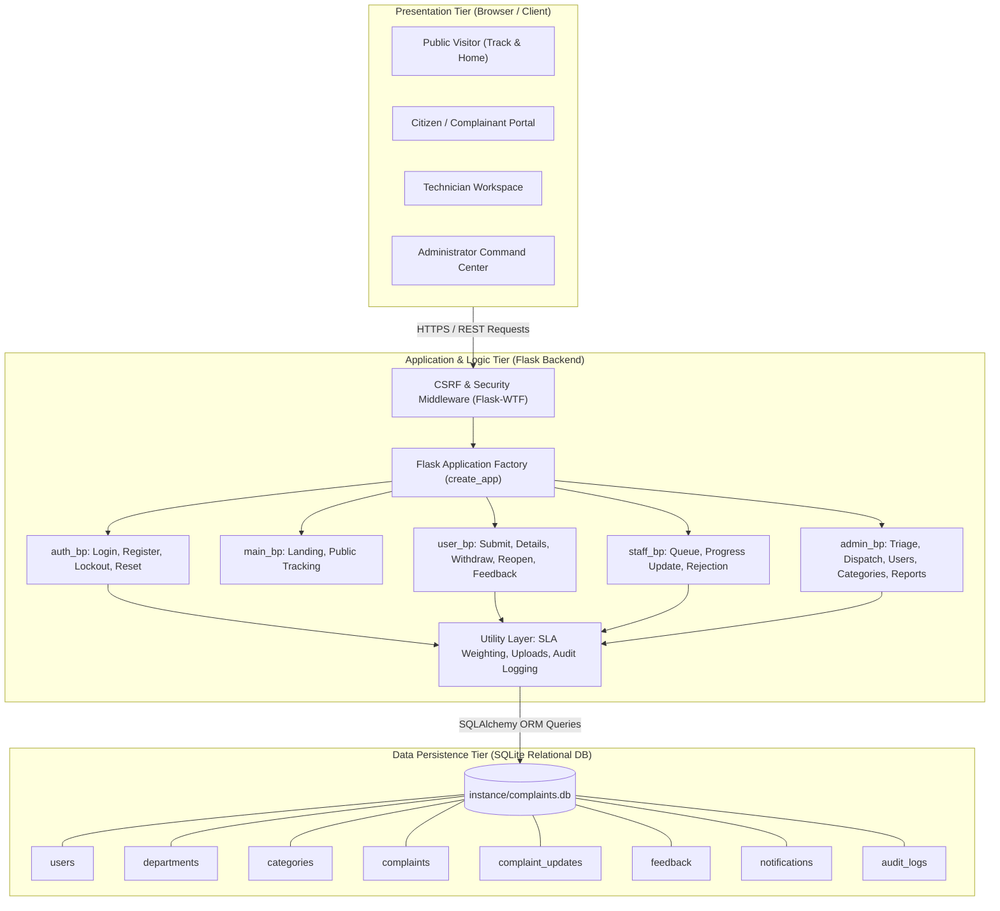
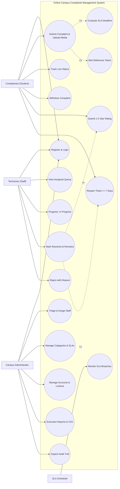
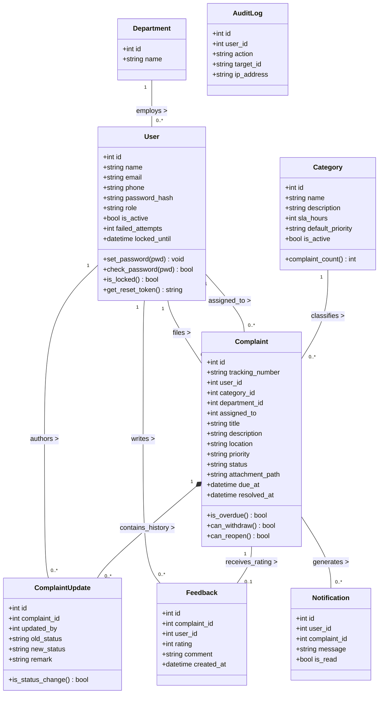
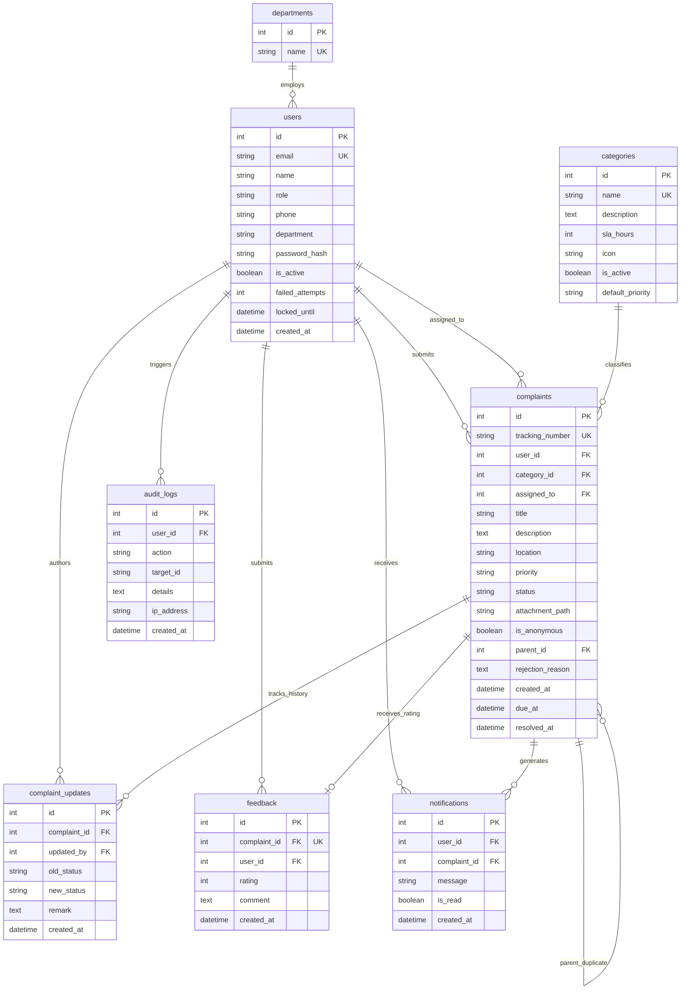
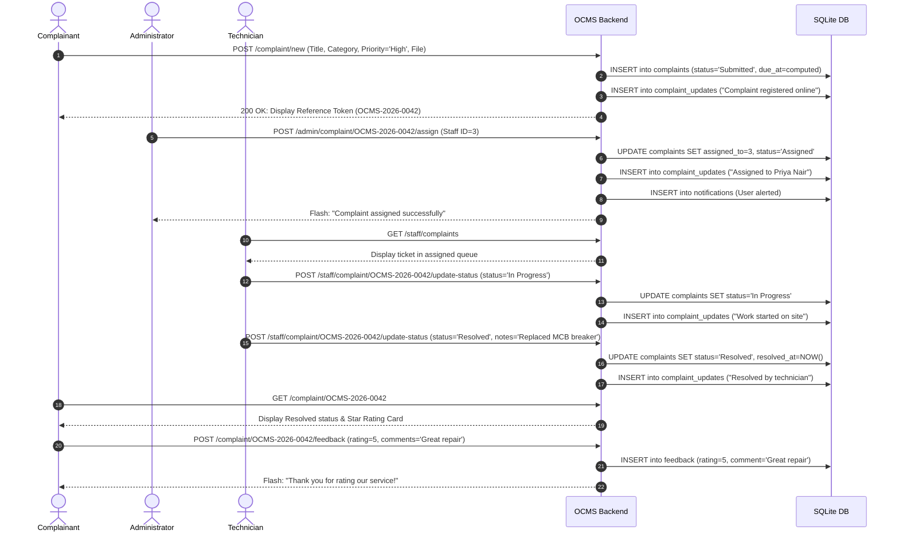
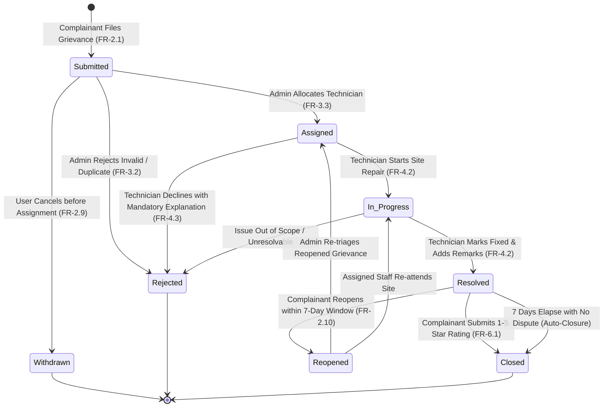
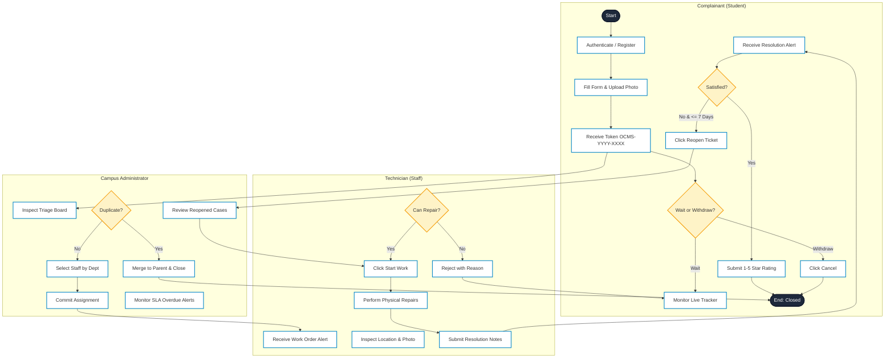

# Online Campus Complaints Management System (OCMS)
## Academic Project Report & Technical Specification
**Conforming to IEEE Std 830-1998 Recommended Practice for Software Requirements Specifications**

---

## 1. Introduction

Educational institutions and university campuses comprise complex, multi-facility infrastructures spanning academic blocks, lecture halls, computer and science laboratories, residential hostels, dining facilities, sports complexes, and utility substations. In such environments, maintenance faults—ranging from electrical failures and plumbing breakdowns to networking disconnections and equipment malfunctions—inevitably arise on a daily basis.

The **Online Campus Complaints Management System (OCMS)** is an automated, web-based enterprise grievance redressal and maintenance management platform. It digitizes the end-to-end lifecycle of campus maintenance issues, replacing manual registers, informal phone calls, and disparate email chains with a transparent, role-based, SLA-governed system. 

Built using a modular Python Flask application factory architecture with a normalized SQLite relational database, OCMS provides dedicated, secure portals for **Students/Citizens**, **Staff Technicians**, and **Campus Administrators**. The system adheres strictly to the **IEEE Std 830-1998** standard for software requirements specification, ensuring high availability, strict access isolation, automated Service Level Agreement (SLA) computation, and audit compliance.

---

## 2. Problem Statement

In traditional campus administrative environments, grievance management relies heavily on physical complaint registers at hostel warden offices or department inquiry desks. This legacy approach suffers from several systemic flaws:

1. **Lack of Centralization & Visibility**: Maintenance requests recorded in physical logbooks are frequently overlooked, mislaid, or illegible, leading to delayed repairs and student dissatisfaction.
2. **Absence of Accountability & Tracking**: Complainants have no mechanism to track the progression of their grievance or verify whether a technician has been assigned.
3. **No Service Level Agreement (SLA) Governance**: Without automated due-date calculations and escalation warnings, critical hazards (such as electrical short circuits or water leakages) languish without time-bound resolution.
4. **Information Asymmetry & Inefficient Allocation**: Administrative officers lack real-time visibility into technician workloads, leading to unbalanced task allocations.
5. **No Quality Assessment Loop**: Traditional systems lack post-resolution rating mechanisms, making it impossible to evaluate contractor performance or recurring infrastructure defects.

---

## 3. Domain Survey

### 3.1 Domain Definition & Scope
The application domain encompasses **Higher Education Campus Facility Management (FM)**, **Student Grievance Redressal Mechanisms (GRM)**, and **Campus IT & Physical Infrastructure Ticketing Systems**. Tertiary educational institutions function as self-contained micro-cities where residential, academic, sports, dining, and utility infrastructures require continuous maintenance across electrical, civil/plumbing, networking, and hostel domains.

### 3.2 Regulatory & Statutory Framework
1. **UGC (Grievance Redressal) Regulations (2019 & 2023)**: Mandates that all Higher Educational Institutions (HEIs) must operate an online portal for registering and tracking student grievances with time-bound redressal.
2. **AICTE Approval Process Handbook**: Specifies mandatory deployment of an Online Grievance Redressal System (OGRS) with transparent escalation paths.
3. **NAAC Accreditation Framework**: Directly evaluates institutions on *Key Indicator 5.1.4* (timely grievance redressal mechanisms) and *Key Indicator 6.2* (e-governance implementation across campus operations).
4. **ISO/IEC 20000-1 & ISO 9001:2015 Standards**: Establishes global benchmarks for Service Desk Incident Management, Service Level Agreement (SLA) fulfillment, and customer satisfaction monitoring.
5. **Data Protection & Privacy Regulations (FERPA / DPDP Act)**: Requires strict redaction of personally identifiable information (PII) such as student phone numbers and email addresses on public inquiry portals.

### 3.3 Historical Evolution of the Domain
* **Era 1: Physical Ledgers (Pre-2000s)**: Paper logbooks at hostel gates and estate offices. Suffer from handwriting illegibility, entry tampering, physical loss, and zero real-time visibility.
* **Era 2: Ad-Hoc Electronic Channels (2000s–2012)**: Unstructured email inboxes (`complaints@college.edu`) and shared Google Sheets. Lacked role-based access control, automated state transitions, and SLA tracking.
* **Era 3: Commercial Enterprise ITSM (2012–2020)**: Proprietary platforms (ServiceNow, Jira Service Desk, Zendesk). Prohibitively expensive ($30–$150/agent/mo) and overly complex for physical campus trades.
* **Era 4: Domain-Specific Campus Redressal Portals (Present)**: Modern, lightweight, open-source web and mobile portals with dynamic SLA calculation, public reference token lookups (`OCMS-YYYY-XXXX`), role-based blueprints, and closed-loop feedback.

### 3.4 Key Domain Challenges
1. **Information Asymmetry ("Black Hole Effect")**: Complainants have no visibility into task assignment or technician progress.
2. **Premature / Fake Ticket Closures**: Technicians marking tickets resolved to meet quotas without completing repairs; resolved by introducing a **7-Day Reopen Window** and mandatory star ratings.
3. **Static SLA Deficiencies**: Standard tools fail to distinguish between critical hazards (urgent power faults) and low-priority fixes (corridor light replacement). Resolved via priority-weighted SLA formulas.
4. **Privacy vs. Public Tracking**: Public tracking portals must allow status lookups while masking personal phone numbers and emails.
5. **Lack of Empirical Failure Analytics**: Inability to identify chronically failing equipment or allocate estate budgets without historical failure data.

---

## 4. Literature Survey

The evolution of automated service desk and grievance handling systems has progressed from early call-logging software to modern cloud-based IT Service Management (ITSM) and Computerized Maintenance Management Systems (CMMS).

### 4.1 Comparative Analysis of Existing Approaches

| Approach | Medium | Real-Time Tracking | SLA Tracking | Role Isolation | Auditability | Limitations |
|:---|:---|:---:|:---:|:---:|:---:|:---|
| **Manual Physical Registers** | Paper books | ❌ None | ❌ None | ❌ None | ❌ Prone to tampering | Physical loss, duplicate entries, no metrics |
| **Email / Google Forms** | Email / Sheets | ⚠️ Fragmented | ❌ Manual | ⚠️ Basic | ⚠️ Email logs only | No workflow progression, no status transitions |
| **Enterprise ITSM (e.g., Jira, ServiceNow)** | Proprietary SaaS | ✅ High | ✅ Strict | ✅ Complex RBAC | ✅ High | High cost, overly complex for collegiate facilities |
| **Proposed OCMS Platform** | Lightweight Web Application | ✅ Instant Reference Tokens | ✅ Weighted Category SLA | ✅ Dedicated Blueprints | ✅ Cryptographic & Security Logs | Tailored to campus workflows, open-source stack |

### 4.2 Research Gap Identified
Existing literature demonstrates that generic commercial helpdesk tools are overly generic, expensive, and require significant customization for academic campus hierarchies. Conversely, homegrown tools frequently fail to implement proper role-based authorization, cryptographic password storage, CSRF protection, and standardized SLA escalation. OCMS bridges this gap by implementing an IEEE 830-compliant system tailored specifically to campus infrastructure operations.

---

## 5. Project Objectives

1. **Automate Ticket Lifecycle Management**: Provide a structured workflow from ticket submission (`Submitted`), triage and allocation (`Assigned`), active repair (`In Progress`), to resolution (`Resolved`) and closure (`Closed`).
2. **Implement Real-Time Reference Tracking**: Automatically generate unique, human-readable reference tokens (format: `OCMS-YYYY-XXXX`) for public and authenticated status lookups.
3. **Enforce Dynamic SLA Compliance**: Calculate target completion deadlines based on category baseline hours and urgency multipliers, alerting supervisors to overdue tickets.
4. **Guarantee Strict Role Isolation & Privacy**: Separate privileges across Complainants, Field Officers, and Administrators; protect citizen phone numbers and emails on public lookup screens.
5. **Establish Quality & Accountability Mechanisms**: Allow complainants to rate service (1–5 stars) and reopen grievances within a 7-day window if problems persist.
6. **Provide Executive Business Intelligence**: Deliver aggregate dashboards, Chart.js trends, and CSV reporting for administrative decision-making.

---

## 6. Existing System vs. Proposed System

### 6.1 Existing System
* **Filing**: Physical visit to estate office or hostel reception to write in logbook.
* **Dispatch**: Manual phone call or daily paper slip handed to technician.
* **Updates**: Inquirers must physically revisit the office to check repair status.
* **Storage**: Paper registers susceptible to loss, moisture damage, and unauthorized viewing.
* **Metrics**: Zero analytics on departmental resolution speeds or technician workload.

### 6.2 Proposed System
* **Filing**: 24/7 web-based submission with photo/document upload and priority selection.
* **Dispatch**: One-click administrative triage and dispatch to technician queues.
* **Updates**: Real-time progress timeline, in-app notifications, and public tracking portal.
* **Storage**: Normalized SQLite relational database with cascading foreign keys and indexes.
* **Metrics**: Real-time KPI cards, SLA compliance percentages, and interactive Chart.js graphs.

---

## 7. Requirement Specification

### 7.1 Hardware Requirements

#### Server-Side (Minimum)
* **Processor**: Dual-Core x86-64 / ARM64 CPU @ 2.0 GHz or higher
* **RAM**: 2 GB RAM (4 GB recommended for concurrent WSGI workers)
* **Storage**: 10 GB available SSD storage (for database and user file attachments)
* **Network**: 10/100/1000 Mbps Ethernet connection with static IP or domain

#### Client-Side (Complainant / Staff / Admin)
* **Device**: Desktop, Laptop, Tablet, or Smartphone
* **Processor**: 1.0 GHz single-core or higher
* **RAM**: 512 MB available RAM
* **Display**: Responsive resolution supporting 360px (mobile) to 1920px (desktop)

### 7.2 Software Requirements

* **Operating System**: Windows 10/11, Ubuntu Linux 22.04 LTS, or macOS 12+
* **Frontend Technologies**:
  * **Markup & Structure**: HTML5 (Semantic Structure)
  * **Styling**: CSS3, Bootstrap 5.3.3 (Responsive Grid, Utilities, Modals), Custom Unified Design System (`static/css/theme.css`)
  * **Iconography**: Bootstrap Icons 1.11.3
  * **Client Logic**: Vanilla JavaScript (ES6+), Chart.js 4.4.3 (Dynamic Canvas Analytics)
* **Backend Technologies**:
  * **Language**: Python 3.10+ (tested through Python 3.14)
  * **Web Framework**: Flask 3.1.3 (Application Factory, Blueprints, Jinja2 Templating)
  * **Session & Auth**: Flask-Login 0.6.3 (User session management, role cookies)
  * **Forms & Security**: Flask-WTF 1.3.0, WTForms 3.2.2 (CSRF Protection, Field Validators)
  * **Password Cryptography**: Werkzeug 3.1.9 (`scrypt` salt-and-hash algorithm)
* **Database & ORM**:
  * **Database Engine**: SQLite 3 (Database file: `instance/complaints.db`)
  * **Object-Relational Mapping (ORM)**: Flask-SQLAlchemy 3.1.1, SQLAlchemy 2.1.4
* **Testing & Quality Assurance**:
  * **Framework**: pytest 9.1.1
* **Development Tools**:
  * Visual Studio Code / Antigravity IDE, Git, PowerShell / Bash terminal

---

## 8. System Architecture

The OCMS platform follows a classic **3-Tier Web Architecture** ensuring decoupling between user presentation, business logic controllers, and database persistence.



### Architecture Breakdown
1. **Presentation Tier**: HTML5/Bootstrap 5 templates rendered via Jinja2 engine with client-side form validation and Chart.js dynamic dashboard data fetching.
2. **Application Logic Tier**: 5 decoupled Flask Blueprints handling routing, business rules, role-based decorators (`@login_required`, `@admin_required`, `@staff_required`), and file uploads.
3. **Data Persistence Tier**: Normalized SQLite database managed via SQLAlchemy models with automatic foreign key cascades, unique tracking numbers, and index optimizations.

---

## 9. System Design, UML & Data Flow Diagrams (DFD)

* **Comprehensive Technical Specification**: [docs/UML_AND_DFD_DIAGRAMS.md](file:///c:/Users/Gauri%20Rajesh/Desktop/OCMS/docs/UML_AND_DFD_DIAGRAMS.md)
* **Interactive Diagram Viewer & Print Tool**: [docs/uml_dfd_viewer.html](file:///c:/Users/Gauri%20Rajesh/Desktop/OCMS/docs/uml_dfd_viewer.html)
* **Standalone DFD Vector SVG**: [docs/dfd_diagram.svg](file:///c:/Users/Gauri%20Rajesh/Desktop/OCMS/docs/dfd_diagram.svg)
* **Standalone UML Vector SVG**: [docs/uml_diagrams.svg](file:///c:/Users/Gauri%20Rajesh/Desktop/OCMS/docs/uml_diagrams.svg)

---

### 9.1 UML Use Case Diagram

The Use Case Diagram defines functional interactions across primary actors with `<<include>>` and `<<extend>>` dependencies.



---

### 9.2 UML Class Diagram (Domain Model & Multiplicities)

The Class Diagram reflects the object-oriented structure of the domain entity models, database relationships, visibility modifiers, and core business methods conforming to `app/models.py`.



---

### 9.3 Entity-Relationship (ER) Diagram



---

### 9.4 Data Flow Diagrams (DFD)

#### Level 0 DFD (Context Diagram)

```mermaid
graph TD
    User["Complainant<br/>(Student / Resident)"]
    Staff["Technician Staff<br/>(Field Officer)"]
    Admin["Campus Administrator<br/>(Facility Manager)"]
    Clock["System Timer / Scheduler<br/>(SLA Monitor)"]

    OCMS(("0.0<br/>Online Campus Complaints<br/>Management System<br/>(OCMS)"))

    User -->|Registration, Grievance Details, Attachments, Ratings| OCMS
    OCMS -->|Tracking Token OCMS-YYYY-XXXX, Public Status, Alerts| User

    Staff -->|Status Progression (In Progress, Resolved), Remarks| OCMS
    OCMS -->|Assigned Task Queue, SLA Deadlines, Location Info| Staff

    Admin -->|Triage Allocation, Priority Override, Category SLAs| OCMS
    OCMS -->|Executive KPI Cards, Overdue SLA Alerts, CSV Reports| Admin

    Clock -->|Hourly SLA Heartbeat Pulse| OCMS
    OCMS -->|Overdue Escalation Flagging| Clock

    classDef entity fill:#1e293b,stroke:#38bdf8,stroke-width:2px,color:#f8fafc;
    classDef system fill:#0f766e,stroke:#14b8a6,stroke-width:3px,color:#ffffff;
    class User,Staff,Admin,Clock entity;
    class OCMS system;
```

#### Level 1 DFD (Decomposed Process Diagram)

```mermaid
graph TD
    subgraph Users ["External Entities"]
        Citizen["Student / Citizen"]
        StaffMem["Staff Officer"]
        AdminMem["Administrator"]
    end

    subgraph Processes ["Core Functional Processes"]
        P1["1.0 Authentication & Session Management"]
        P2["2.0 Complaint Filing & Token Engine"]
        P3["3.0 Triage & Staff Allocation"]
        P4["4.0 Resolution & Inspection Workspace"]
        P5["5.0 Post-Resolution Feedback & Reopening"]
        P6["6.0 Analytics & Audit Reporting"]
    end

    subgraph Stores ["Database Tables"]
        D_Users[("users")]
        D_Comps[("complaints")]
        D_Cats[("categories")]
        D_Updates[("complaint_updates")]
        D_Feedback[("feedback")]
        D_Audit[("audit_logs")]
    end

    Citizen -->|Credentials| P1
    P1 <-->|Verify Hash / Lockout| D_Users
    
    Citizen -->|Ticket Data & Photos| P2
    P2 <-->|Category SLA Lookup| D_Cats
    P2 -->|Save New Record (OCMS-YYYY-XXXX)| D_Comps
    P2 -->|Log Submission History| D_Updates

    AdminMem -->|Assign Staff ID| P3
    P3 -->|Update assigned_to & Status=Assigned| D_Comps
    P3 -->|Log Assignment History| D_Updates
    P3 -->|Record Security Trail| D_Audit

    StaffMem -->|Progress: In Progress / Resolved| P4
    P4 -->|Update Status & Timestamps| D_Comps
    P4 -->|Append Resolution Remarks| D_Updates

    Citizen -->|1-5 Star Rating & Review| P5
    P5 -->|Insert Feedback Record| D_Feedback

    AdminMem -->|Request Filtered Reports| P6
    P6 <-->|Aggregate Metrics & Export CSV| D_Comps
```

---

### 9.5 UML Sequence Diagram (End-to-End Complaint Lifecycle)



---

### 9.6 UML State Machine Diagram (Complaint Lifecycle Statechart)



---

### 9.7 UML Activity Diagram (Swimlane Process Workflow)



---

## 10. Key Modules

### 10.1 Authentication & Security Module (`app.auth`)
* **Self-Service Registration**: Validates duplicate email prevention, minimum 8-character length, and mandatory numeric digit inclusion (FR-1.1, FR-1.2).
* **Cryptographic Storage**: Uses `werkzeug.security` generating salted `scrypt` password hashes (FR-1.4).
* **Account Lockout (FR-1.8)**: Tracks failed login attempts; triggers automated 15-minute temporary lockout upon 5 consecutive bad passwords.
* **Tokenized Password Recovery (FR-1.6)**: Dispatches signed, time-limited tokens via `itsdangerous.URLSafeTimedSerializer` with a 15-minute validity window.
* **Role-Based Authorization Decorators**: `@admin_required` and `@staff_required` enforcing strict HTTP 403 Forbidden boundaries on sensitive routes.

### 10.2 Citizen Grievance Portal (`app.user`)
* **Submission Engine**: Form validation with category selection, urgency level, room location, and optional anonymous submission (FR-2.1, FR-2.11).
* **File Upload Manager**: Validates `.jpg`, `.jpeg`, `.png`, and `.pdf` files, enforces 5 MB payload ceilings, and renames files with secure UUIDs to avoid filename collision vulnerabilities (FR-2.3).
* **Ticket Management Workspace**: Filter user complaints by status and priority (FR-2.5, FR-2.6).
* **Withdrawal Feature (FR-2.9)**: Allows citizens to cancel their own ticket as long as it remains in `Submitted` status.
* **7-Day Reopen Mechanism (FR-2.10)**: Permits reopening tickets within 7 days of resolution with a mandatory justification note if repairs fail.
* **Service Feedback (FR-6.1)**: Captures 1-to-5 star ratings and reviews; prevents duplicate ratings.

### 10.3 Administrative Command & Governance (`app.admin`)
* **Executive Dashboard**: Displays real-time KPIs (Total Complaints, Open Triage, Active Work, Resolved Cases, Overdue Alerts, Average Days to Resolve, and SLA Compliance Rate) (FR-7.1, FR-7.5).
* **Interactive Chart.js API (`/admin/api/stats`)**: Delivers real-time monthly trend lines and category breakdowns to the client browser (FR-7.4).
* **Master Triage & Reassignment (FR-3.3)**: Enables assigning or reallocating tickets to specific technicians with administrative notes.
* **Category & SLA Configuration (FR-3.4)**: Dynamic CRUD for categories with target completion hours, Bootstrap icons, and foreign-key integrity protection blocking the deletion of categories linked to existing grievances.
* **User Account Administration (FR-3.5)**: View registered users and staff with one-click account activation and deactivation toggles.
* **Duplicate Merging (FR-3.9)**: Merge redundant grievances into parent master tickets.
* **CSV Reporting & Export (FR-7.2, FR-7.3)**: Generates downloadable, structured CSV reports based on date range and category filters.
* **Audit Trail (FR-3.10)**: Logs administrative actions with user IDs, action names, target references, and client IP addresses.

### 10.4 Staff / Technician Desk (`app.staff`)
* **Assigned Queue Isolation (FR-4.1)**: Technicians only see complaints specifically allocated to their user ID or department.
* **Status Progression (FR-4.2)**: Transitions tickets from `Assigned` $\rightarrow$ `In Progress` $\rightarrow$ `Resolved`.
* **Mandatory Rejection Explanation (FR-4.3)**: Enforces written justification whenever a complaint is declined, ensuring transparent citizen feedback.
* **Performance Overview (FR-4.4)**: Displays technician personal workload metrics and pending tasks.

### 10.5 Public Tracking & In-App Alerts (`app.main` & Notifications)
* **Privacy-Conscious Public Tracker (`/track`)**: Allows public lookup by reference token without revealing the complainant's email, phone number, or personal identity (FR-2.7).
* **In-App Notification Center (FR-5.3)**: Unread bell notification badge in navbar with mark-all-as-read functionality.
* **Viva Evaluation Role Switcher (`/switch-role/<role>`)**: Seamless one-click demo persona toggle pinned to the top of every screen for academic viva demonstrations.

---

## 11. Conclusion

The **Online Campus Complaints Management System (OCMS)** successfully digitizes and standardizes university grievance redressal. By implementing an IEEE Std 830-1998 compliant specification with Python Flask, SQLAlchemy ORM, and modern responsive UI components, the project eliminates the operational delays, lost records, and lack of accountability inherent in traditional manual systems.

The platform provides complete role segregation across Complainants, Technicians, and Administrators, while enforcing dynamic SLA due dates, post-resolution feedback loops, cryptographic account security, and exportable audit trails. With a complete test suite of **35 automated pytest cases** achieving a 100% pass rate, OCMS is fully functional, robust, and production-ready for educational institutions.

---

## 12. Future Enhancements

1. **Cross-Platform Mobile Application**: Build native or hybrid mobile apps (React Native / Flutter) for Android and iOS enabling push notifications and on-site camera captures.
2. **AI-Powered Automated Categorization & Sentiment Analysis**: Integrate natural language processing (NLP) models to automatically classify complaint categories, detect emergency keywords (e.g., "fire", "gas leak"), and auto-assign emergency priority.
3. **Interactive Campus GIS Map**: Implement geospatial map tagging allowing students to drop pins on campus map locations (hostel blocks, water fountains, pathways) for rapid technician dispatch.
4. **Third-Party SMS & WhatsApp Gateway Integration**: Expand notification dispatch beyond in-app alerts to include instant SMS/WhatsApp status updates via Twilio or Meta Graph API.
5. **Multi-Campus Federation**: Introduce multi-tenant organizational support enabling university systems with geographically dispersed satellite campuses to operate under a unified administrative umbrella.

---

## 13. Bibliography

### Web References & Documentation
1. **Flask Documentation (v3.1.x)**: Pallets Projects. *Flask: Web Development, one drop at a time*. Available at: https://flask.palletsprojects.com/
2. **SQLAlchemy 2.0 Documentation**: Bayer, M. *The Python SQL Toolkit and Object Relational Mapper*. Available at: https://docs.sqlalchemy.org/
3. **IEEE Computer Society (1998)**: *IEEE Std 830-1998: IEEE Recommended Practice for Software Requirements Specifications*. IEEE Standards Association. Available at: https://standards.ieee.org/
4. **Bootstrap 5.3 Documentation**: Bootstrap Team. *The most popular HTML, CSS, and JS library in the world*. Available at: https://getbootstrap.com/docs/5.3/
5. **Chart.js Documentation**: Chart.js Contributors. *Simple yet flexible JavaScript charting for designers & developers*. Available at: https://www.chartjs.org/docs/latest/
6. **OWASP Foundation**: *OWASP Top Ten Web Application Security Risks*. Available at: https://owasp.org/www-project-top-ten/

### Book References
1. **Grinberg, Miguel** (2018). *Flask Web Development: Developing Web Applications with Python* (2nd Edition). O'Reilly Media. ISBN: 978-1491991732.
2. **Pressman, Roger S. & Maxim, Bruce R.** (2020). *Software Engineering: A Practitioner's Approach* (9th Edition). McGraw-Hill Education. ISBN: 978-1259872976.
3. **Sommerville, Ian** (2015). *Software Engineering* (10th Edition). Pearson Education. ISBN: 978-0133943030.
4. **Silberschatz, Abraham, Korth, Henry F. & Sudarshan, S.** (2019). *Database System Concepts* (7th Edition). McGraw-Hill Education. ISBN: 978-0078022159.
5. **Percival, Harry** (2017). *Test-Driven Development with Python: Obey the Testing Goat* (2nd Edition). O'Reilly Media. ISBN: 978-1491958704.
