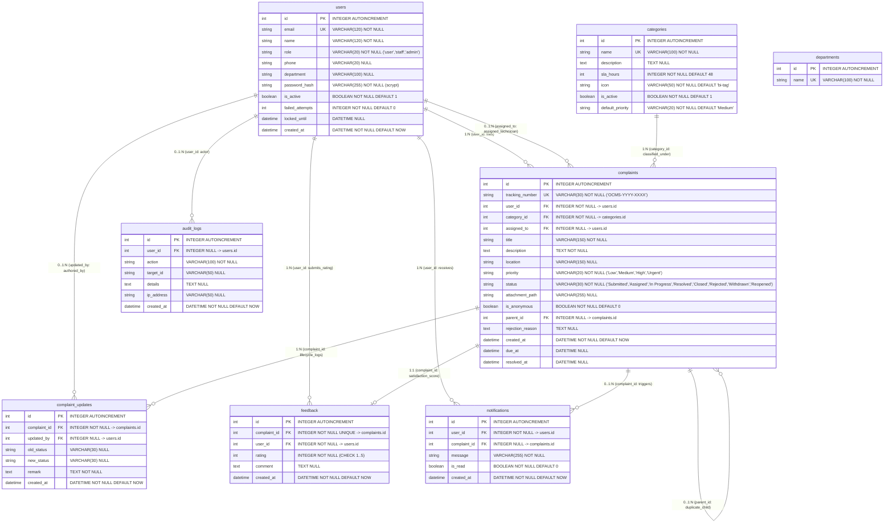

# Online Campus Complaints Management System (OCMS)
## Physical Database Relational Schema Diagram & Data Dictionary
**Conforming to IEEE Std 830-1998 SRS & 3rd Normal Form (3NF) Relational Design**

* **Interactive Vector Schema Diagram**: [docs/schema_diagram.svg](file:///c:/Users/Gauri%20Rajesh/Desktop/OCMS/docs/schema_diagram.svg)
* **Browser Viewer & Print Tool**: [docs/schema_diagram_viewer.html](file:///c:/Users/Gauri%20Rajesh/Desktop/OCMS/docs/schema_diagram_viewer.html)
* **Raw SQLite DDL Script**: [docs/generated/schema.sql](file:///c:/Users/Gauri%20Rajesh/Desktop/OCMS/docs/generated/schema.sql)

---

## 1. Formal Relational Schema (Database Notation)

In formal database relational algebra notation (Primary Keys are **bolded**, Foreign Keys indicated with asterisk `*` and arrow references):

1. **departments** (
   **id**, name
)

2. **users** (
   **id**, email, name, role, phone, department, password_hash, is_active, failed_attempts, locked_until, created_at
)

3. **categories** (
   **id**, name, description, sla_hours, icon, is_active, default_priority
)

4. **complaints** (
   **id**, tracking_number, user_id*, category_id*, assigned_to*, title, description, location, priority, status, attachment_path, is_anonymous, parent_id*, rejection_reason, created_at, due_at, resolved_at
)
   * *Foreign Key `user_id` $\rightarrow$ `users(id)` [ON DELETE CASCADE]*
   * *Foreign Key `category_id` $\rightarrow$ `categories(id)` [ON DELETE RESTRICT]*
   * *Foreign Key `assigned_to` $\rightarrow$ `users(id)` [ON DELETE SET NULL]*
   * *Foreign Key `parent_id` $\rightarrow$ `complaints(id)` [ON DELETE SET NULL]*

5. **complaint_updates** (
   **id**, complaint_id*, updated_by*, old_status, new_status, remark, created_at
)
   * *Foreign Key `complaint_id` $\rightarrow$ `complaints(id)` [ON DELETE CASCADE]*
   * *Foreign Key `updated_by` $\rightarrow$ `users(id)` [ON DELETE SET NULL]*

6. **feedback** (
   **id**, complaint_id*, user_id*, rating, comment, created_at
)
   * *Foreign Key `complaint_id` $\rightarrow$ `complaints(id)` [UNIQUE, ON DELETE CASCADE]*
   * *Foreign Key `user_id` $\rightarrow$ `users(id)` [ON DELETE CASCADE]*

7. **notifications** (
   **id**, user_id*, complaint_id*, message, is_read, created_at
)
   * *Foreign Key `user_id` $\rightarrow$ `users(id)` [ON DELETE CASCADE]*
   * *Foreign Key `complaint_id` $\rightarrow$ `complaints(id)` [ON DELETE SET NULL]*

8. **audit_logs** (
   **id**, user_id*, action, target_id, details, ip_address, created_at
)
   * *Foreign Key `user_id` $\rightarrow$ `users(id)` [ON DELETE SET NULL]*

---

## 2. Visual Entity-Relationship Schema Diagram (Mermaid)



---

## 3. Physical ASCII Layout & Foreign Key Connectors

```
+---------------------+             +---------------------------------------+
|     DEPARTMENTS     |             |                 USERS                 |
+---------------------+             +---------------------------------------+
| PK  id              |             | PK  id                                |
|     name            |             | UK  email                             |
+---------------------+             |     name                              |
                                    |     role ('user','staff','admin')     |
                                    |     phone                             |
+---------------------+             |     department                        |
|     CATEGORIES      |             |     password_hash (scrypt)            |
+---------------------+             |     is_active                         |
| PK  id              |             |     failed_attempts                   |
| UK  name            |             |     locked_until                      |
|     description     |             |     created_at                        |
|     sla_hours       |             +---------------------------------------+
|     icon            |                   |         |        |         |
|     is_active       |                   |         |        |         |
|     default_priority|                   |         |        |         |
+---------------------+                   |         |        |         |
        |                                 |         |        |         |
        | 1:N                             | 1:N     | 0..1:N | 1:N     | 1:N
        |                                 | (files) | (assigned)       | (submits)
        v                                 v         v        |         |
+-------------------------------------------------------+    |         |
|                      COMPLAINTS                       |    |         |
+-------------------------------------------------------+    |         |
| PK  id                                                |<---+         |
| UK  tracking_number ("OCMS-YYYY-XXXX")                |              |
| FK  user_id           --------> users.id              |              |
| FK  category_id       --------> categories.id         |              |
| FK  assigned_to       --------> users.id (NULLable)   |              |
|     title                                             |              |
|     description                                       |              |
|     location                                          |              |
|     priority ('Low','Medium','High','Urgent')         |              |
|     status ('Submitted','Assigned',...,'Closed')      |              |
|     attachment_path                                   |              |
|     is_anonymous                                      |              |
| FK  parent_id         --------> complaints.id (Self)  |              |
|     rejection_reason                                  |              |
|     created_at                                        |              |
|     due_at                                            |              |
|     resolved_at                                       |              |
+-------------------------------------------------------+              |
        |                      |                     |                 |
        | 1:N (history)        | 1:1 (rating)        | 0..1:N (alerts) |
        v                      v                     v                 |
+----------------------+ +--------------------+ +-------------------+ |
|  COMPLAINT_UPDATES   | |      FEEDBACK      | |   NOTIFICATIONS   | |
+----------------------+ +--------------------+ +-------------------+ |
| PK  id               | | PK  id             | | PK  id            | |
| FK  complaint_id     | | FK  complaint_id(UK| | FK  user_id ------>-+
| FK  updated_by       | | FK  user_id ------>+ | FK  complaint_id  |
|     old_status       | |     rating (1..5)  | |     message       |
|     new_status       | |     comment        | |     is_read       |
|     remark           | |     created_at     | |     created_at    |
|     created_at       | +--------------------+ +-------------------+
+----------------------+
```

---

## 4. Comprehensive Table Data Dictionary

### Table 1: `users`
Represents all system actors across the 3 core application roles.

| Column | Type | Nullable | Key / Constraint | Description |
|:---|:---|:---:|:---:|:---|
| `id` | INTEGER | NO | **PRIMARY KEY (AUTOINCREMENT)** | Unique internal user record identifier |
| `email` | VARCHAR(120) | NO | **UNIQUE** | Complainant or staff institutional email address |
| `name` | VARCHAR(120) | NO | - | Full legal name of user |
| `role` | VARCHAR(20) | NO | DEFAULT `'user'` | Access control role: `'user'`, `'staff'`, or `'admin'` |
| `phone` | VARCHAR(20) | YES | - | Contact phone number (redacted on public screens) |
| `department` | VARCHAR(100) | YES | - | Academic or maintenance department affiliation |
| `password_hash` | VARCHAR(255) | NO | - | Salted `scrypt` cryptographic password hash |
| `is_active` | BOOLEAN | NO | DEFAULT `1` | Account status toggle (deactivated users cannot log in) |
| `failed_attempts`| INTEGER | NO | DEFAULT `0` | Consecutive bad login counter (triggers 15m lockout) |
| `locked_until` | DATETIME | YES | - | Timestamp until which login attempts are rejected |
| `created_at` | DATETIME | NO | DEFAULT `CURRENT_TIMESTAMP` | Account registration timestamp |

* **Indexes**: `idx_users_email` (B-Tree), `idx_users_role` (B-Tree)

---

### Table 2: `departments`
Stores academic and infrastructure operational branches.

| Column | Type | Nullable | Key / Constraint | Description |
|:---|:---|:---:|:---:|:---|
| `id` | INTEGER | NO | **PRIMARY KEY (AUTOINCREMENT)** | Unique department identifier |
| `name` | VARCHAR(100) | NO | **UNIQUE** | Department name (e.g., Electrical, Estate, IT Services) |

---

### Table 3: `categories`
Defines maintenance trades, baseline resolution hours, and UI icons.

| Column | Type | Nullable | Key / Constraint | Description |
|:---|:---|:---:|:---:|:---|
| `id` | INTEGER | NO | **PRIMARY KEY (AUTOINCREMENT)** | Unique category identifier |
| `name` | VARCHAR(100) | NO | **UNIQUE** | Category name (e.g., Electrical, Plumbing, Hostel) |
| `description` | TEXT | YES | - | Functional scope of the category |
| `sla_hours` | INTEGER | NO | DEFAULT `48` | Baseline target resolution duration in hours |
| `icon` | VARCHAR(50) | NO | DEFAULT `'bi-tag'` | Bootstrap 5 icon class name for frontend styling |
| `is_active` | BOOLEAN | NO | DEFAULT `1` | Active availability toggle |
| `default_priority` | VARCHAR(20) | NO | DEFAULT `'Medium'` | Default priority pre-selected on form submission |

---

### Table 4: `complaints`
The central transaction table recording all filed maintenance requests and their lifecycle progression.

| Column | Type | Nullable | Key / Constraint | Description |
|:---|:---|:---:|:---:|:---|
| `id` | INTEGER | NO | **PRIMARY KEY (AUTOINCREMENT)** | Internal integer record identifier |
| `tracking_number` | VARCHAR(30) | NO | **UNIQUE** | Reference token (e.g., `OCMS-2026-0001`) |
| `user_id` | INTEGER | NO | **FOREIGN KEY $\rightarrow$ users(id)** | Complainant identifier (`ON DELETE CASCADE`) |
| `category_id` | INTEGER | NO | **FOREIGN KEY $\rightarrow$ categories(id)** | Maintenance category (`ON DELETE RESTRICT`) |
| `assigned_to` | INTEGER | YES | **FOREIGN KEY $\rightarrow$ users(id)** | Allocated technician (`ON DELETE SET NULL`) |
| `title` | VARCHAR(150) | NO | - | Short descriptive title of grievance |
| `description` | TEXT | NO | - | Detailed description of the fault |
| `location` | VARCHAR(150) | YES | - | Specific room / hostel block / laboratory location |
| `priority` | VARCHAR(20) | NO | DEFAULT `'Medium'` | Urgency: `'Low'`, `'Medium'`, `'High'`, `'Urgent'` |
| `status` | VARCHAR(30) | NO | DEFAULT `'Submitted'` | Lifecycle state: `'Submitted'`, `'Assigned'`, `'In Progress'`, `'Resolved'`, `'Closed'`, `'Rejected'`, `'Withdrawn'`, `'Reopened'` |
| `attachment_path`| VARCHAR(255)| YES | - | Relative path to uploaded photographic/document proof |
| `is_anonymous` | BOOLEAN | NO | DEFAULT `0` | If `1`, complainant identity is masked from technicians |
| `parent_id` | INTEGER | YES | **FOREIGN KEY $\rightarrow$ complaints(id)** | Self-referencing FK for duplicate ticket merging |
| `rejection_reason`| TEXT | YES | - | Mandatory explanation if ticket is rejected by staff |
| `created_at` | DATETIME | NO | DEFAULT `CURRENT_TIMESTAMP` | Initial ticket filing timestamp |
| `due_at` | DATETIME | YES | - | Target resolution deadline computed via SLA formula |
| `resolved_at` | DATETIME | YES | - | Timestamp when technician marks work as `Resolved` |

* **Indexes**: `idx_complaints_tracking`, `idx_complaints_status`, `idx_complaints_user_id`, `idx_complaints_assigned_to`, `idx_complaints_category_id`

---

### Table 5: `complaint_updates`
Maintains an immutable timeline of status updates, remarks, and audit comments.

| Column | Type | Nullable | Key / Constraint | Description |
|:---|:---|:---:|:---:|:---|
| `id` | INTEGER | NO | **PRIMARY KEY (AUTOINCREMENT)** | Unique update log identifier |
| `complaint_id` | INTEGER | NO | **FOREIGN KEY $\rightarrow$ complaints(id)** | Linked complaint (`ON DELETE CASCADE`) |
| `updated_by` | INTEGER | YES | **FOREIGN KEY $\rightarrow$ users(id)** | Staff/Admin who executed update (`ON DELETE SET NULL`)|
| `old_status` | VARCHAR(30) | YES | - | Previous status prior to transition |
| `new_status` | VARCHAR(30) | YES | - | New status after transition |
| `remark` | TEXT | NO | - | Technician notes or administrative remarks |
| `created_at` | DATETIME | NO | DEFAULT `CURRENT_TIMESTAMP` | Log creation timestamp |

* **Indexes**: `idx_updates_complaint_id`

---

### Table 6: `feedback`
Captures post-resolution citizen satisfaction evaluations.

| Column | Type | Nullable | Key / Constraint | Description |
|:---|:---|:---:|:---:|:---|
| `id` | INTEGER | NO | **PRIMARY KEY (AUTOINCREMENT)** | Unique rating identifier |
| `complaint_id` | INTEGER | NO | **FOREIGN KEY $\rightarrow$ complaints(id)** | Unique 1-to-1 link (`ON DELETE CASCADE`, **UNIQUE**) |
| `user_id` | INTEGER | NO | **FOREIGN KEY $\rightarrow$ users(id)** | Submitting complainant (`ON DELETE CASCADE`) |
| `rating` | INTEGER | NO | CHECK (`rating >= 1 AND rating <= 5`)| Star rating score (1 to 5) |
| `comment` | TEXT | YES | - | Qualitative review comments |
| `created_at` | DATETIME | NO | DEFAULT `CURRENT_TIMESTAMP` | Feedback submission timestamp |

---

### Table 7: `notifications`
Powers in-app real-time bell alerts for status changes and administrative notices.

| Column | Type | Nullable | Key / Constraint | Description |
|:---|:---|:---:|:---:|:---|
| `id` | INTEGER | NO | **PRIMARY KEY (AUTOINCREMENT)** | Notification identifier |
| `user_id` | INTEGER | NO | **FOREIGN KEY $\rightarrow$ users(id)** | Recipient user (`ON DELETE CASCADE`) |
| `complaint_id` | INTEGER | YES | **FOREIGN KEY $\rightarrow$ complaints(id)** | Linked complaint (`ON DELETE SET NULL`) |
| `message` | VARCHAR(255) | NO | - | Alert notification text |
| `is_read` | BOOLEAN | NO | DEFAULT `0` | Unread (`0`) or Read (`1`) badge indicator |
| `created_at` | DATETIME | NO | DEFAULT `CURRENT_TIMESTAMP` | Alert dispatch timestamp |

* **Indexes**: `idx_notifications_user_id`

---

### Table 8: `audit_logs`
Cryptographic and operational audit trail tracking critical security and administrative actions.

| Column | Type | Nullable | Key / Constraint | Description |
|:---|:---|:---:|:---:|:---|
| `id` | INTEGER | NO | **PRIMARY KEY (AUTOINCREMENT)** | Audit entry identifier |
| `user_id` | INTEGER | YES | **FOREIGN KEY $\rightarrow$ users(id)** | Performing user (`ON DELETE SET NULL`) |
| `action` | VARCHAR(100) | NO | - | Event name (e.g., `ASSIGN_COMPLAINT`, `DELETE_CATEGORY`)|
| `target_id` | VARCHAR(50) | YES | - | Target identifier (tracking token or user ID) |
| `details` | TEXT | YES | - | JSON or plaintext event description |
| `ip_address` | VARCHAR(50) | YES | - | Client IPv4 / IPv6 network address |
| `created_at` | DATETIME | NO | DEFAULT `CURRENT_TIMESTAMP` | Audit event timestamp |

* **Indexes**: `idx_audit_logs_created_at`

---

## 5. Referential Integrity & Cascade Rules Summary

| Parent Table | Child Table | Foreign Key Column | On Delete Action | On Update Action | Rationale |
|:---|:---|:---|:---:|:---:|:---|
| `users` | `complaints` | `user_id` | **CASCADE** | CASCADE | If a student account is expunged, all their filed complaints are purged. |
| `users` | `complaints` | `assigned_to` | **SET NULL** | CASCADE | If a technician resigns, assigned tickets return to the unassigned queue. |
| `categories` | `complaints` | `category_id` | **RESTRICT** | CASCADE | **Prevents orphan tickets**: Admin cannot delete categories linked to tickets. |
| `complaints` | `complaints` | `parent_id` | **SET NULL** | CASCADE | If a parent master ticket is deleted, duplicate tickets unlink gracefully. |
| `complaints` | `complaint_updates`| `complaint_id`| **CASCADE** | CASCADE | Deleting a complaint purges its chronological timeline logs. |
| `users` | `complaint_updates`| `updated_by` | **SET NULL** | CASCADE | Timeline history preserved even if technician account is removed. |
| `complaints` | `feedback` | `complaint_id` | **CASCADE** | CASCADE | Feedback belongs strictly to the specific complaint life cycle (1:1). |
| `users` | `feedback` | `user_id` | **CASCADE** | CASCADE | User deletion cascades to their reviews. |
| `users` | `notifications` | `user_id` | **CASCADE** | CASCADE | Purging a user cleans up their inbox notifications. |
| `complaints` | `notifications` | `complaint_id` | **SET NULL** | CASCADE | If a ticket is deleted, notification record persists with unlinked reference. |
| `users` | `audit_logs` | `user_id` | **SET NULL** | CASCADE | Audit trail remains immutable for institutional compliance. |
