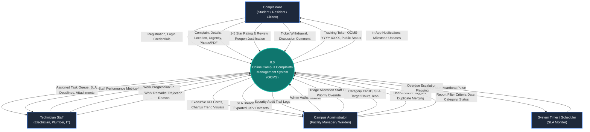
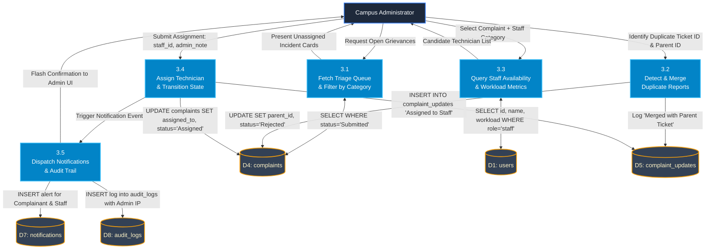
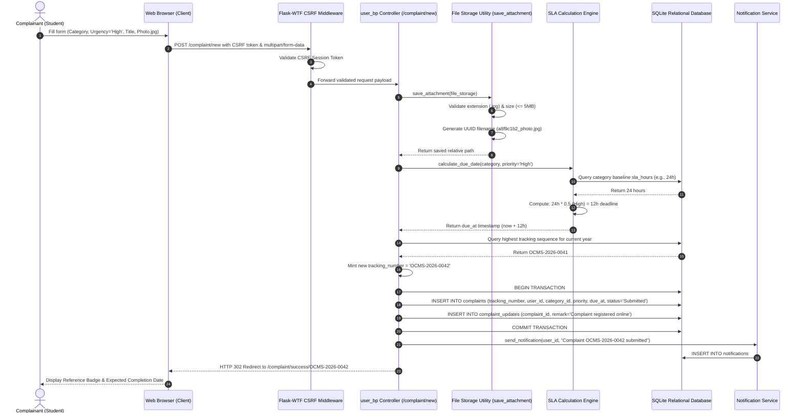
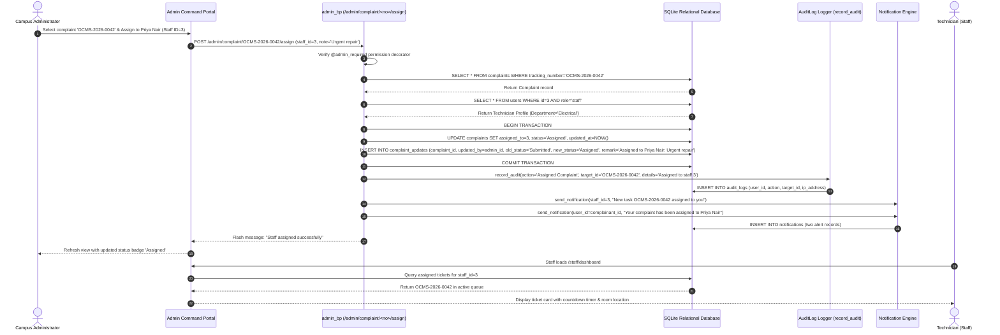
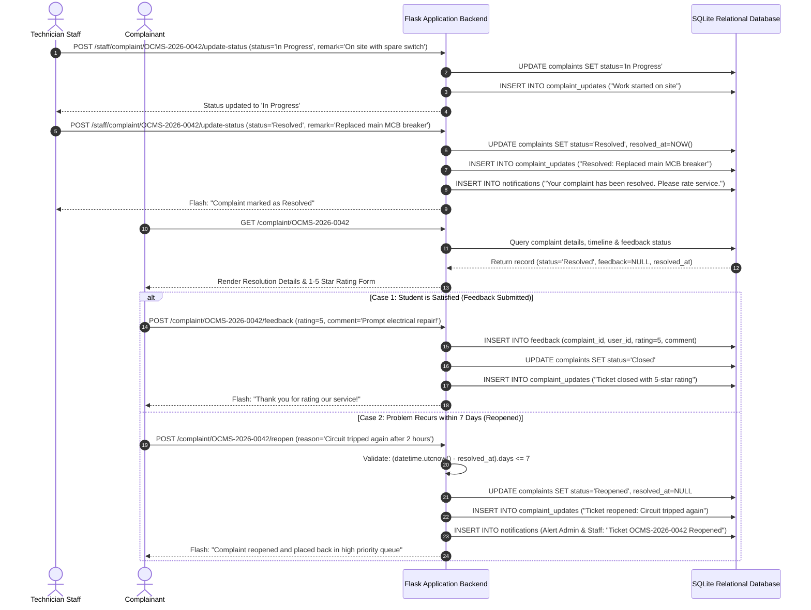
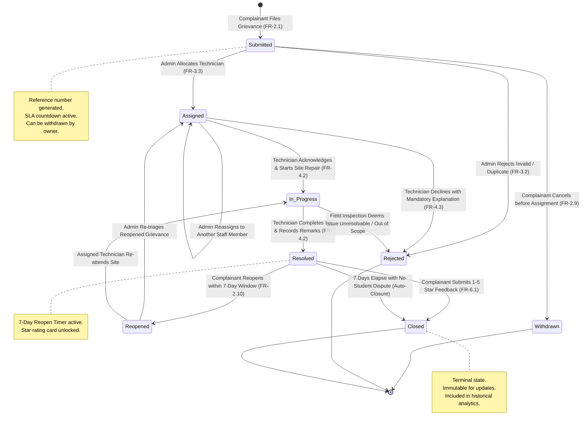
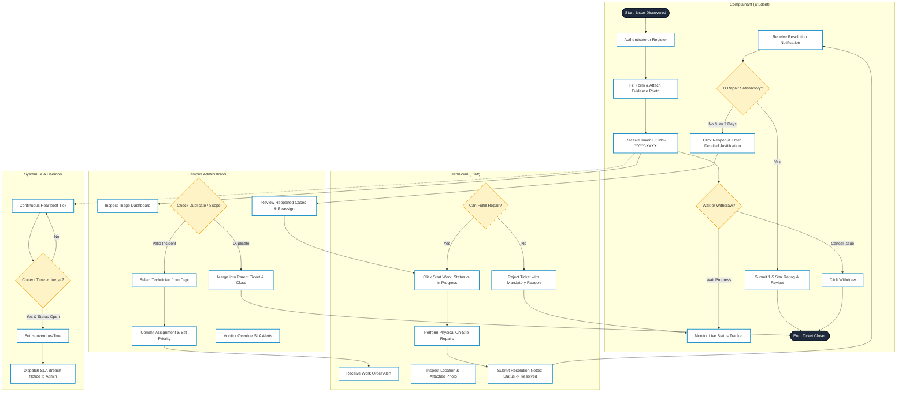
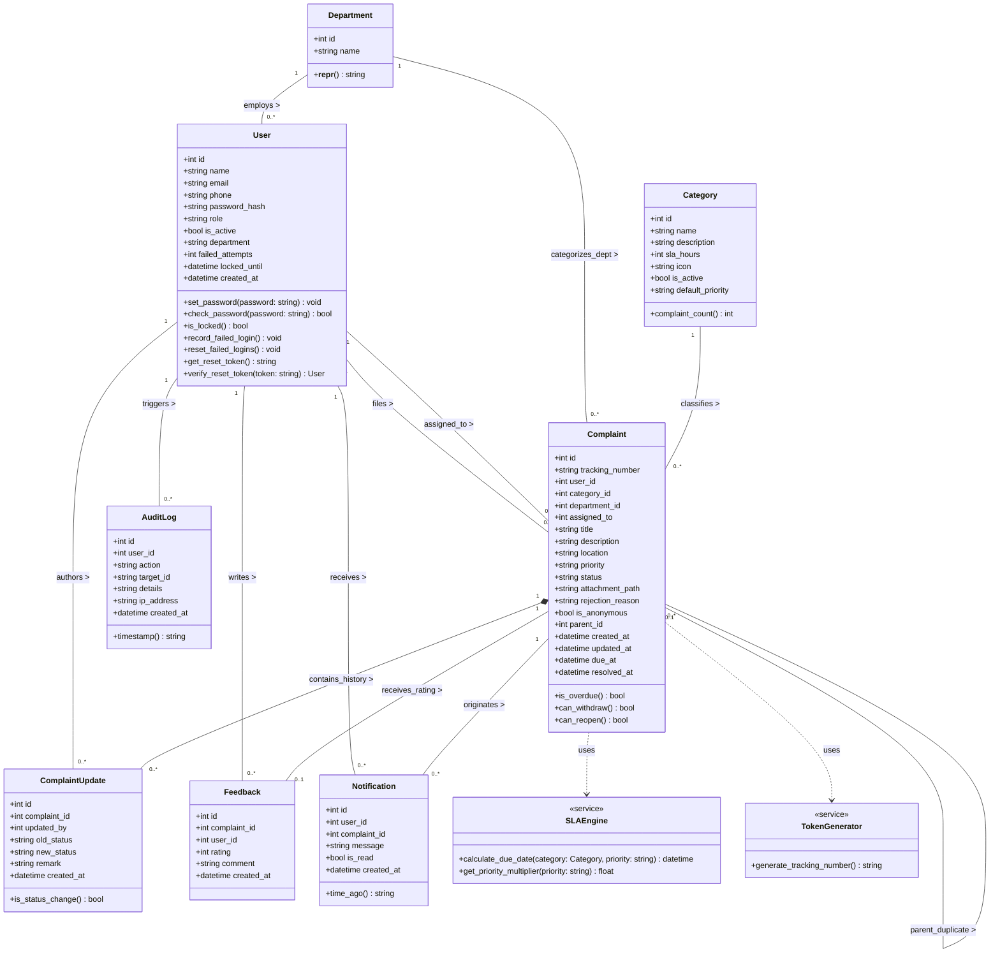
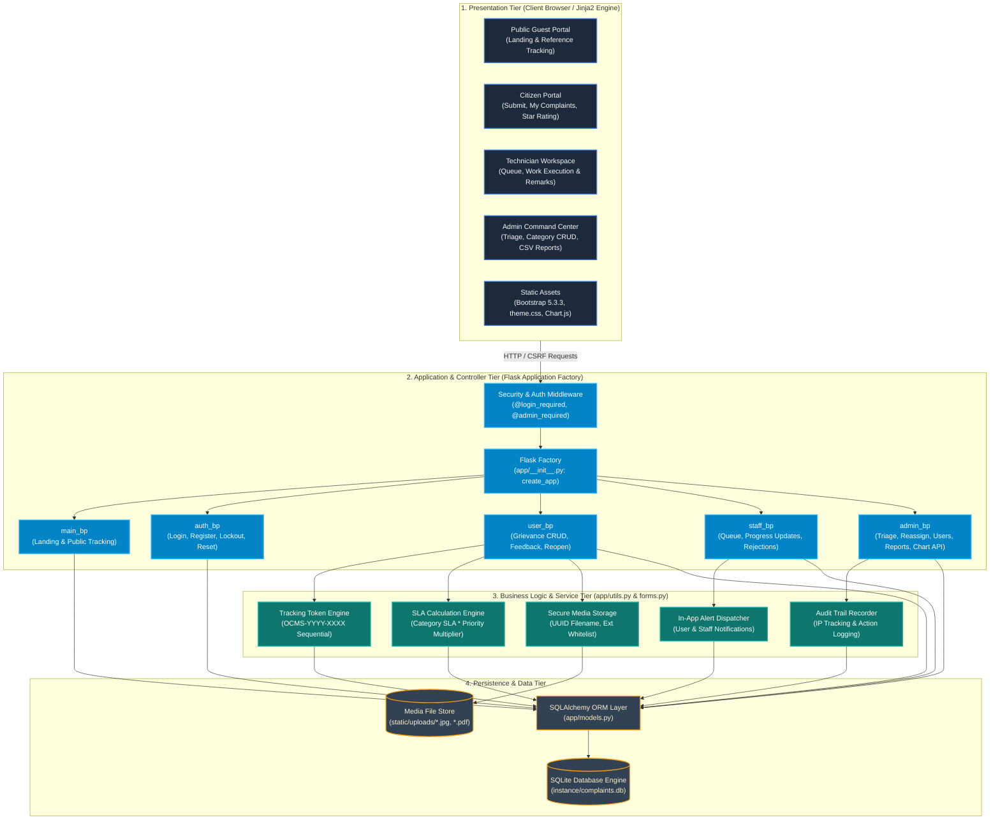

# Online Campus Complaints Management System (OCMS)
## System Design: Comprehensive UML & Data Flow Diagrams (DFD) Specification
**Document Version:** 1.0  
**Standard Compliance:** IEEE Std 830-1998 (SRS) & ISO/IEC/IEEE 42010 Systems Architecture  
**Author / System:** OCMS Engineering & System Architecture Team  
**Date:** October 2026  

---

## Table of Contents
1. [Executive Summary & Notation Standards](#1-executive-summary--notation-standards)
2. [Data Flow Diagrams (DFD)](#2-data-flow-diagrams-dfd)
   - [2.1 DFD Level 0: Context Analysis Diagram](#21-dfd-level-0-context-analysis-diagram)
   - [2.2 DFD Level 1: Subsystem Functional Decomposition](#22-dfd-level-1-subsystem-functional-decomposition)
   - [2.3 DFD Level 2.1: Complaint Filing & SLA Token Engine](#23-dfd-level-21-complaint-filing--sla-token-engine)
   - [2.4 DFD Level 2.2: Administrative Triage & Staff Allocation](#24-dfd-level-22-administrative-triage--staff-allocation)
   - [2.5 DFD Level 2.3: Work Execution, Resolution & 7-Day Reopen Loop](#25-dfd-level-23-work-execution-resolution--7-day-reopen-loop)
   - [2.6 Data Dictionary of Flows & Stores](#26-data-dictionary-of-flows--stores)
3. [UML Behavioral Diagrams](#3-uml-behavioral-diagrams)
   - [3.1 Use Case Diagram (Actors, Boundaries, Includes & Extends)](#31-use-case-diagram)
   - [3.2 Sequence Diagram 1: Complaint Submission & Dynamic SLA Computation](#32-sequence-diagram-1-complaint-submission--dynamic-sla-computation)
   - [3.3 Sequence Diagram 2: Administrative Triage & Technician Allocation](#33-sequence-diagram-2-administrative-triage--technician-allocation)
   - [3.4 Sequence Diagram 3: Repair Execution, Star Rating & 7-Day Reopening](#34-sequence-diagram-3-repair-execution-star-rating--7-day-reopening)
   - [3.5 State Machine Diagram: Complaint Lifecycle Statechart](#35-state-machine-diagram-complaint-lifecycle-statechart)
   - [3.6 Activity Diagram: End-to-End Swimlane Workflow](#36-activity-diagram-end-to-end-swimlane-workflow)
4. [UML Structural Diagrams](#4-uml-structural-diagrams)
   - [4.1 Class Diagram (Full Domain Model, Operations & Multiplicities)](#41-class-diagram)
   - [4.2 Component Diagram (3-Tier Blueprint & Module Architecture)](#42-component-diagram)
   - [4.3 Deployment Diagram (Physical Nodes, WSGI, File System & DB Engine)](#43-deployment-diagram)
5. [Traceability Matrix (SRS Requirements to Diagrammatic Artifacts)](#5-traceability-matrix)

---

## 1. Executive Summary & Notation Standards

This technical specification details the structural, behavioral, and data-flow models of the **Online Campus Complaints Management System (OCMS)**. OCMS is an enterprise-grade grievance redressal web application tailored for higher education campuses, residential hostels, and departmental facilities.

### 1.1 Diagrammatic Conventions

#### Data Flow Diagrams (DFD)
DFD diagrams follow the standard **Yourdon & DeMarco / Gane & Sarson** conventions:
* **External Entities (Square / Box)**: External actors producing or consuming data (`Student/Citizen`, `Technician/Staff`, `Administrator`, `System Clock/Scheduler`).
* **Processes (Rounded Rectangle / Circle)**: Transformations of data designated by numbering hierarchy (`0.0`, `1.0` through `6.0`, `2.1` through `2.5`).
* **Data Stores (Open-ended Rectangle / Double Bar)**: Persistent tables within the relational database (`D1: users`, `D2: categories`, `D3: complaints`, etc.).
* **Data Flows (Directed Arrows)**: Named packets of information traveling between entities, processes, and stores.

#### Unified Modeling Language (UML 2.5)
* **Use Case Diagrams**: Depicts functional goals across primary actors, featuring `<<include>>` (mandatory sub-routines) and `<<extend>>` (conditional workflows).
* **Class Diagrams**: Documents object-oriented entity classes, attributes with visibility (`+` public, `-` private, `#` protected), data types, member operations, associations, and exact multiplicities.
* **Sequence Diagrams**: Chronological interaction graphs illustrating messages passing across lifelines with activation boxes and return parameters.
* **State Machine Diagrams**: Finite state transition graph detailing valid lifecycle states (`Submitted`, `Assigned`, `In Progress`, `Resolved`, `Closed`, `Rejected`, `Withdrawn`, `Reopened`).
* **Component & Deployment Diagrams**: Architectural topology mapping modular Python Flask Blueprints, ORM abstractions, SQLite database files, and network tiers.

---

## 2. Data Flow Diagrams (DFD)

### 2.1 DFD Level 0: Context Analysis Diagram

The Level 0 Context Diagram establishes the boundary of the OCMS system, illustrating all external entities that interact directly with the environment and the core data payloads exchanged.



#### Primary Input & Output Data Flows (Level 0)

| External Entity | Inbound Data Flow to OCMS | Outbound Data Flow from OCMS |
|:---|:---|:---|
| **Complainant (User)** | Registration profile, login credentials, complaint payload (category, urgency, location, description, photo attachment), discussion comments, withdrawal request, 1–5 star rating, reopen reason. | Dynamic tracking number (`OCMS-YYYY-XXXX`), public status lookup response, real-time in-app notifications, complaint lifecycle timeline updates. |
| **Technician (Staff)** | Staff login credentials, status transition requests (`In Progress`, `Resolved`), repair remarks, mandatory rejection reasons. | Filtered assigned work queue, incident location, complainant contact/location details, SLA countdown timer. |
| **Campus Administrator** | Staff triage assignments, priority overrides, category & SLA hour configurations, user account activations/deactivations, duplicate parent-child links, report filter parameters. | Real-time KPI summaries, overdue ticket escalation notices, downloadable CSV reports, Chart.js analytics payloads, immutable audit logs. |
| **System Timer / Clock** | Chronological tick / SLA verification trigger. | Tickets flagged as `is_overdue = True`, escalation notifications. |

---

### 2.2 DFD Level 1: Subsystem Functional Decomposition

The Level 1 DFD decomposes the monolithic system into **6 major functional processes** and shows how data moves between external actors, processes, and the **8 normalized database tables (Data Stores)**.

```mermaid
graph TD
    %% Entities
    E_User["Complainant (Student)"]
    E_Staff["Technician (Staff)"]
    E_Admin["Administrator"]
    E_Clock["Timer / SLA Daemon"]

    %% Processes
    P1["1.0<br/>Authentication &<br/>Profile Governance"]
    P2["2.0<br/>Complaint Ingestion &<br/>Token Generation"]
    P3["3.0<br/>Administrative Triage<br/>& Allocation"]
    P4["4.0<br/>Staff Work Order<br/>& Progress Tracking"]
    P5["5.0<br/>Service Rating,<br/>Feedback & Reopen"]
    P6["6.0<br/>Analytics, Audit Trail<br/>& SLA Monitoring"]

    %% Data Stores
    D1[("D1: users")]
    D2[("D2: categories")]
    D3[("D3: departments")]
    D4[("D4: complaints")]
    D5[("D5: complaint_updates")]
    D6[("D6: feedback")]
    D7[("D7: notifications")]
    D8[("D8: audit_logs")]

    %% P1 Auth Flows
    E_User -->|Credentials, Email, Password| P1
    E_Staff -->|Staff Credentials| P1
    E_Admin -->|Admin Credentials| P1
    P1 <-->|Verify Hash / Lockout (15 min)| D1
    P1 -->|Log Auth Success / Failure| D8
    P1 -->|Session Token & User Role| E_User

    %% P2 Complaint Ingestion Flows
    E_User -->|Title, Category, Urgency, Room, Media| P2
    P2 <-->|Read Category SLA Hours| D2
    P2 -->|Generate OCMS-YYYY-XXXX & Insert| D4
    P2 -->|Record Initial History Event| D5
    P2 -->|Return Reference Token| E_User

    %% P3 Triage & Assignment Flows
    E_Admin -->|Assign Staff ID, Priority Override| P3
    P3 <-->|Query Technicians by Department| D1
    P3 <-->|Lookup Submitted Grievances| D4
    P3 -->|Update assigned_to, status='Assigned'| D4
    P3 -->|Append Assignment Remark| D5
    P3 -->|Dispatch User & Staff Notification| D7
    P3 -->|Write Action to Audit Log| D8

    %% P4 Staff Work Order Flows
    E_Staff -->|Update: In Progress / Resolved / Reject| P4
    P4 <-->|Fetch Assigned Tickets for Staff ID| D4
    P4 -->|Update status, resolved_at Timestamp| D4
    P4 -->|Append Work Remark / Rejection Reason| D5
    P4 -->|Trigger Milestone Notification| D7

    %% P5 Feedback & Reopen Flows
    E_User -->|1-5 Star Rating & Feedback Comment| P5
    E_User -->|Reopen Justification Note (<=7 Days)| P5
    P5 -->|Insert Rating Record| D6
    P5 -->|Update status='Closed' on Feedback| D4
    P5 -->|Update status='Reopened' on Escalation| D4
    P5 -->|Log Reopen History Event| D5
    P5 -->|Alert Admin of Reopened Case| D7

    %% P6 SLA & Reporting Flows
    E_Clock -->|Time Check Pulse| P6
    E_Admin -->|Request Filtered Reports / CSV Export| P6
    P6 <-->|Query Grievance Metrics & SLA Deadlines| D4
    P6 <-->|Fetch Audit Trail Records| D8
    P6 -->|Write Overdue Alert Notification| D7
    P6 -->|CSV Dataset & Chart API Data| E_Admin

    %% Notification Read Flows
    D7 -->|In-App Unread Alerts| E_User
    D7 -->|Task Assignment Alerts| E_Staff

    %% Styling
    classDef entity fill:#1e293b,stroke:#3b82f6,stroke-width:2px,color:#f8fafc;
    classDef process fill:#0284c7,stroke:#38bdf8,stroke-width:2px,color:#ffffff;
    classDef store fill:#334155,stroke:#f59e0b,stroke-width:2px,color:#fef3c7;
    class E_User,E_Staff,E_Admin,E_Clock entity;
    class P1,P2,P3,P4,P5,P6 process;
    class D1,D2,D3,D4,D5,D6,D7,D8 store;
```

---

### 2.3 DFD Level 2.1: Complaint Filing & SLA Token Engine

This diagram decomposes **Process 2.0 (Complaint Ingestion & Token Generation)** into granular subprocesses, detailing data validation, UUID media storage, SLA computation, and reference number generation.

```mermaid
graph TD
    %% Entity
    Complainant["Complainant (Student)"]

    %% Sub-processes of 2.0
    P2_1["2.1<br/>Validate Payload<br/>(CSRF & Fields)"]
    P2_2["2.2<br/>File Attachment<br/>Validation & UUID Save"]
    P2_3["2.3<br/>Compute Dynamic SLA<br/>Target Due Date"]
    P2_4["2.4<br/>Generate Sequential<br/>Tracking Token"]
    P2_5["2.5<br/>Commit Complaint<br/>& Event Log"]

    %% Data Stores
    D_Cat[("D2: categories")]
    D_Comp[("D4: complaints")]
    D_Upd[("D5: complaint_updates")]
    FS[("File System:<br/>/static/uploads/")]

    %% Flows
    Complainant -->|Form Post: Category, Title, Priority, Room, File| P2_1
    P2_1 -->|Sanitized Form Data| P2_2
    P2_2 -->|Raw Binary Stream (.jpg, .png, .pdf <= 5MB)| FS
    FS -->|Unique Stored Filename uuid_name.ext| P2_2
    P2_2 -->|Validated Attachment Path| P2_3

    P2_3 <-->|Read category.sla_hours| D_Cat
    P2_3 -->|Compute due_at = now + base * multiplier| P2_4

    P2_4 <-->|Query latest OCMS-YYYY-XXXX| D_Comp
    P2_4 -->|Next Tracking Number OCMS-2026-0042| P2_5

    P2_5 -->|INSERT INTO complaints status='Submitted'| D_Comp
    P2_5 -->|INSERT INTO complaint_updates 'Registered'| D_Upd
    P2_5 -->|Return Success Screen with Token| Complainant

    %% Styling
    classDef entity fill:#1e293b,stroke:#3b82f6,stroke-width:2px,color:#f8fafc;
    classDef process fill:#0284c7,stroke:#38bdf8,stroke-width:2px,color:#ffffff;
    classDef store fill:#334155,stroke:#f59e0b,stroke-width:2px,color:#fef3c7;
    class Complainant entity;
    class P2_1,P2_2,P2_3,P2_4,P2_5 process;
    class D_Cat,D_Comp,D_Upd,FS store;
```

#### Detailed Process Specifications for Subprocess 2.0

* **Process 2.1 (Validate Payload)**: Validates title length (3–200 chars), non-empty description, room/location string, and verifies CSRF session token.
* **Process 2.2 (Media Storage)**: Validates extension against whitelist (`.png`, `.jpg`, `.jpeg`, `.pdf`) and ensures payload $\le 5\text{ MB}$. Generates 12-char hex UUID prefix (`uuid4().hex[:12] + '_' + secure_filename`) to prevent overwrite attacks.
* **Process 2.3 (SLA Computation)**:
  $$\text{SLA Hours} = \max\left(4, \text{base\_hours} \times \text{multiplier}\right)$$
  Where $\text{Urgent}=0.25$, $\text{High}=0.50$, $\text{Medium}=1.0$, $\text{Low}=1.50$.
* **Process 2.4 (Sequential Token Minting)**: Queries database for highest sequence in current calendar year (`OCMS-YYYY-XXXX`), increments counter with race-condition safety.
* **Process 2.5 (Commit & Log)**: Atomically writes complaint entity with status `Submitted`, inserts first timeline record in `complaint_updates`, and issues confirmation.

---

### 2.4 DFD Level 2.2: Administrative Triage & Staff Allocation

Decomposes **Process 3.0 (Administrative Triage & Allocation)** into five sub-operations.



---

### 2.5 DFD Level 2.3: Work Execution, Resolution & 7-Day Reopen Loop

Decomposes **Processes 4.0 and 5.0**, illustrating the field technician resolution steps and the student quality assurance loop.

```mermaid
graph TD
    Staff["Technician Staff"]
    Complainant["Complainant (Student)"]

    P4_1["4.1<br/>Retrieve Personal Queue<br/>& View Attachments"]
    P4_2["4.2<br/>Progress Work Status<br/>('In Progress')"]
    P4_3["4.3<br/>Complete Repair or<br/>Reject with Reason"]
    P5_1["5.1<br/>Capture 1-5 Star<br/>Rating & Review"]
    P5_2["5.2<br/>Evaluate 7-Day Reopen<br/>Window & Escalate"]

    D_Comp[("D4: complaints")]
    D_Upd[("D5: complaint_updates")]
    D_Feed[("D6: feedback")]
    D_Notif[("D7: notifications")]

    Staff -->|Access /staff/complaints| P4_1
    P4_1 <-->|SELECT WHERE assigned_to=staff_id| D_Comp
    P4_1 -->|Render Incident Work Order & Media| Staff

    Staff -->|Click 'Start Work'| P4_2
    P4_2 -->|UPDATE status='In Progress'| D_Comp
    P4_2 -->|INSERT update 'Work started on site'| D_Upd
    P4_2 -->|Notify Complainant: Work Started| D_Notif

    Staff -->|Submit Repair Notes or Rejection Reason| P4_3
    P4_3 -->|UPDATE status='Resolved' OR 'Rejected', resolved_at=now| D_Comp
    P4_3 -->|INSERT update remark / rejection_reason| D_Upd
    P4_3 -->|Notify Complainant of Completion| D_Notif

    Complainant -->|Option A: Submit 5-Star Rating & Comment| P5_1
    P5_1 -->|INSERT INTO feedback rating, comment| D_Feed
    P5_1 -->|UPDATE complaints SET status='Closed'| D_Comp
    P5_1 -->|INSERT update 'Closed with 5-star rating'| D_Upd

    Complainant -->|Option B: Unsatisfied within 7 Days| P5_2
    P5_2 <-->|Check resolved_at + 7 days > now()| D_Comp
    P5_2 -->|UPDATE status='Reopened'| D_Comp
    P5_2 -->|INSERT update 'Reopened by student: Reason'| D_Upd
    P5_2 -->|Notify Admin & Staff of Reopening| D_Notif

    classDef entity fill:#1e293b,stroke:#3b82f6,stroke-width:2px,color:#f8fafc;
    classDef process fill:#0284c7,stroke:#38bdf8,stroke-width:2px,color:#ffffff;
    classDef store fill:#334155,stroke:#f59e0b,stroke-width:2px,color:#fef3c7;
    class Staff,Complainant entity;
    class P4_1,P4_2,P4_3,P5_1,P5_2 process;
    class D_Comp,D_Upd,D_Feed,D_Notif store;
```

---

### 2.6 Data Dictionary of Flows & Stores

| Store / Flow Identifier | Name | Schema / Composition Structure | Purpose |
|:---|:---|:---|:---|
| **D1: users** | User Registry | `id (PK), email (UK), name, phone, password_hash, role, is_active, department, failed_attempts, locked_until, created_at` | Manages credentials, roles (`user`, `staff`, `admin`), and security lockout timers. |
| **D2: categories** | Incident Categories | `id (PK), name (UK), description, sla_hours, icon, is_active, default_priority` | Defines service categories (Electrical, Plumbing, Network, Hostel) and baseline SLA hours. |
| **D3: departments** | Campus Sections | `id (PK), name (UK)` | Administrative lookup grouping technicians into campus departments. |
| **D4: complaints** | Complaint Ledger | `id (PK), tracking_number (UK), user_id (FK), category_id (FK), department_id (FK), assigned_to (FK), title, description, location, priority, status, attachment_path, rejection_reason, is_anonymous, parent_id (FK), created_at, due_at, resolved_at` | Central repository of all campus tickets, tracking lifecycle states and SLA deadlines. |
| **D5: complaint_updates** | Activity Timeline | `id (PK), complaint_id (FK), updated_by (FK), old_status, new_status, remark, created_at` | Append-only audit history of every status progression, comment, and reassignment. |
| **D6: feedback** | Customer Satisfaction | `id (PK), complaint_id (FK, UK), user_id (FK), rating (1-5), comment, created_at` | Stores single post-resolution rating per grievance to quantify service quality. |
| **D7: notifications** | In-App Alerts | `id (PK), user_id (FK), complaint_id (FK), message, is_read, created_at` | Asynchronous milestone alerts dispatched to students and staff. |
| **D8: audit_logs** | Security Audit Trail | `id (PK), user_id (FK), action, target_id, details, ip_address, created_at` | Regulatory audit log capturing privileged administrative actions with IP addresses. |

---

## 3. UML Behavioral Diagrams

### 3.1 Use Case Diagram

```mermaid
graph LR
    %% Actors
    ActorUser["Complainant<br/>(Student / Resident)"]
    ActorStaff["Staff Technician<br/>(Field Officer)"]
    ActorAdmin["Campus Administrator<br/>(System Admin)"]
    ActorClock["SLA Scheduler<br/>(System Daemon)"]

    subgraph SystemBoundary ["Online Campus Complaints Management System (OCMS)"]
        %% Complainant Use Cases
        UC_Reg["UC-01: Register & Verify Account"]
        UC_Login["UC-02: Authenticate & Establish Session"]
        UC_Lock["UC-03: Temporary Lockout (5 Fails)"]
        UC_Reset["UC-04: Reset Password via Timed Token"]
        UC_Submit["UC-05: Submit Grievance & Upload Media"]
        UC_Token["UC-06: Mint Tracking Number (OCMS-YYYY-XXXX)"]
        UC_CalcSLA["UC-07: Compute Weighted SLA Deadline"]
        UC_Track["UC-08: Track Status (Public & Private)"]
        UC_Comment["UC-09: Post Discussion Comment"]
        UC_Withdraw["UC-10: Withdraw Pending Grievance"]
        UC_Rate["UC-11: Submit 1-5 Star Service Rating"]
        UC_Reopen["UC-12: Reopen Grievance (within 7 Days)"]

        %% Staff Use Cases
        UC_Queue["UC-13: View Assigned Work Queue"]
        UC_WorkProgress["UC-14: Progress Status to In Progress"]
        UC_Resolve["UC-15: Complete Repair & Enter Notes"]
        UC_Reject["UC-16: Reject Ticket with Mandatory Reason"]

        %% Admin Use Cases
        UC_Triage["UC-17: Master Triage & Staff Allocation"]
        UC_Override["UC-18: Override Priority / Reassign"]
        UC_Merge["UC-19: Merge Duplicate Tickets"]
        UC_CatCRUD["UC-20: Configure Categories & Baseline SLAs"]
        UC_UserToggle["UC-21: Toggle User Accounts & Permissions"]
        UC_Reports["UC-22: Generate Analytics & Export CSV"]
        UC_Audit["UC-23: Inspect Security Audit Trail"]

        %% System SLA Use Cases
        UC_Overdue["UC-24: Monitor SLA Breaches & Flag Overdue"]
        UC_Notify["UC-25: Dispatch In-App Notifications"]
    end

    %% Complainant Associations
    ActorUser --> UC_Reg
    ActorUser --> UC_Login
    ActorUser --> UC_Reset
    ActorUser --> UC_Submit
    ActorUser --> UC_Track
    ActorUser --> UC_Comment
    ActorUser --> UC_Withdraw
    ActorUser --> UC_Rate
    ActorUser --> UC_Reopen

    %% Staff Associations
    ActorStaff --> UC_Login
    ActorStaff --> UC_Queue
    ActorStaff --> UC_WorkProgress
    ActorStaff --> UC_Resolve
    ActorStaff --> UC_Reject
    ActorStaff --> UC_Comment

    %% Admin Associations
    ActorAdmin --> UC_Login
    ActorAdmin --> UC_Triage
    ActorAdmin --> UC_Override
    ActorAdmin --> UC_Merge
    ActorAdmin --> UC_CatCRUD
    ActorAdmin --> UC_UserToggle
    ActorAdmin --> UC_Reports
    ActorAdmin --> UC_Audit

    %% Scheduler Associations
    ActorClock --> UC_Overdue

    %% Includes & Extends
    UC_Submit -.->|<<include>>| UC_CalcSLA
    UC_Submit -.->|<<include>>| UC_Token
    UC_Submit -.->|<<include>>| UC_Notify

    UC_Login -.->|<<extend>>| UC_Lock

    UC_Resolve -.->|<<extend>>| UC_Rate
    UC_Resolve -.->|<<extend>>| UC_Reopen

    UC_Triage -.->|<<include>>| UC_Notify
    UC_WorkProgress -.->|<<include>>| UC_Notify
    UC_Resolve -.->|<<include>>| UC_Notify
    UC_Overdue -.->|<<include>>| UC_Notify

    %% Styling
    classDef actor fill:#1e293b,stroke:#3b82f6,stroke-width:2px,color:#f8fafc;
    classDef usecase fill:#f8fafc,stroke:#0284c7,stroke-width:2px,color:#0f172a;
    class ActorUser,ActorStaff,ActorAdmin,ActorClock actor;
    class UC_Reg,UC_Login,UC_Lock,UC_Reset,UC_Submit,UC_Token,UC_CalcSLA,UC_Track,UC_Comment,UC_Withdraw,UC_Rate,UC_Reopen,UC_Queue,UC_WorkProgress,UC_Resolve,UC_Reject,UC_Triage,UC_Override,UC_Merge,UC_CatCRUD,UC_UserToggle,UC_Reports,UC_Audit,UC_Overdue,UC_Notify usecase;
```

The Use Case Diagram defines all system interactions across the four actors (**Complainant**, **Staff Technician**, **Campus Administrator**, and **System SLA Scheduler**), highlighting `<<include>>` and `<<extend>>` dependencies.



---

### 3.2 Sequence Diagram 1: Complaint Submission & Dynamic SLA Computation

Demonstrates synchronous and asynchronous calls when a student lodges a grievance with media attachment.



---

### 3.3 Sequence Diagram 2: Administrative Triage & Technician Allocation

Illustrates how the Campus Administrator reviews submitted complaints, verifies technician capacity, reallocates, and triggers alerts.



---

### 3.4 Sequence Diagram 3: Repair Execution, Star Rating & 7-Day Reopening

Details the closing loop where the technician marks resolution, followed by student satisfaction rating or 7-day reopening.



---

### 3.5 State Machine Diagram: Complaint Lifecycle Statechart

The state transition graph specifies the valid lifecycle of a grievance record from inception to archival.



---

### 3.6 Activity Diagram: End-to-End Swimlane Workflow

The Activity Diagram displays the complete operational workflow partitioned across organizational swimlanes.



---

## 4. UML Structural Diagrams

### 4.1 Class Diagram

The Class Diagram illustrates the object-oriented structure of the domain entity models, database relationships, visibility modifiers, and core business methods conforming to `app/models.py` and `app/utils.py`.



#### Detailed Class Specifications

1. **`User`**:
   - Manages identity, contact info, and role security (`user`, `staff`, `admin`).
   - Implements automated brute-force protection (`failed_attempts`, `locked_until`) locking out logins after 5 consecutive bad credentials for 15 minutes.
   - Provides time-limited signed tokens using `itsdangerous.URLSafeTimedSerializer`.
2. **`Complaint`**:
   - Central domain entity recording ticket details, SLA target date (`due_at`), physical location, attachment path, and status.
   - Computes dynamic status flags including `is_overdue` and supports anonymization where user contact details are concealed on public interfaces.
3. **`Category`**:
   - Controls baseline resolution expectations (`sla_hours`) and visual icon representations.
4. **`ComplaintUpdate`**:
   - Maintains an append-only timeline documenting old and new status changes, technician progress notes, and administrative triage actions.
5. **`Feedback`**:
   - Captures strict 1–5 integer satisfaction ratings and optional written reviews, constrained to a `1:1` unique relationship with resolved complaints.
6. **`AuditLog`**:
   - Regulatory security entity recording operator ID, action performed, target entity, client IP address, and UTC timestamp.

---

### 4.2 Component Diagram

The Component Diagram details the 3-Tier modular architecture of the Python Flask application, illustrating blueprint controllers, service utilities, ORM persistence, and file system storage.



---

### 4.3 Deployment Diagram

The Deployment Diagram details physical and virtual nodes, execution containers, processes, network ports, and storage interfaces.

```mermaid
graph TD
    subgraph ClientNode ["Client Device (Desktop / Tablet / Smartphone)"]
        ClientBrowser["Modern Web Browser<br/>(Google Chrome, Mozilla Firefox, Apple Safari, Edge)<br/>HTML5, Bootstrap 5 UI, Chart.js Visualizer"]
    end

    subgraph WebServerNode ["Application Server Node (Linux / Windows Host)"]
        subgraph WebServerTier ["Reverse Proxy / Web Server"]
            ReverseProxy["Nginx / Waitress Web Server<br/>Port 80 (HTTP) / Port 443 (HTTPS)<br/>SSL/TLS Termination & Static Asset Serving"]
        end

        subgraph WSGIContainer ["Python WSGI Execution Container (Python 3.10+)"]
            Gunicorn["WSGI Server (Gunicorn / Waitress)<br/>Workers: 2-4 Synchronous Workers"]
            FlaskCore["Flask 3.1.3 Application Factory<br/>Session Cookies, CSRF Validator, Blueprints"]
        end

        subgraph LocalFileSystem ["Local Server File System"]
            DBFile[("SQLite Relational Database<br/>instance/complaints.db<br/>ACID Transactions, Foreign Keys")]
            MediaFolder[("Uploads Directory<br/>static/uploads/<br/>UUID Sanitized Media Storage")]
        end
    end

    subgraph ExternalServices ["External Infrastructure Services"]
        SMTPServer["Campus / Cloud SMTP Gateway<br/>(Port 587 TLS)<br/>Optional Email Alert Dispatcher"]
    end

    %% Network Connections
    ClientBrowser -->|HTTPS / WSS Requests (Port 443)| ReverseProxy
    ReverseProxy -->|Internal Proxy Pass (Port 5000)| Gunicorn
    Gunicorn --> FlaskCore
    FlaskCore -->|File I/O Reads/Writes| DBFile
    FlaskCore -->|Save Uploaded Photos / PDFs| MediaFolder
    FlaskCore -.->|SMTP Protocol (STARTTLS)| SMTPServer

    classDef client fill:#1e293b,stroke:#3b82f6,stroke-width:2px,color:#f8fafc;
    classDef server fill:#0f172a,stroke:#38bdf8,stroke-width:2px,color:#ffffff;
    classDef node fill:#1e293b,stroke:#94a3b8,stroke-width:1px,color:#f8fafc;
    classDef store fill:#334155,stroke:#f59e0b,stroke-width:2px,color:#fef3c7;
    class ClientBrowser client;
    class ReverseProxy,Gunicorn,FlaskCore server;
    class DBFile,MediaFolder store;
```

---

## 5. Traceability Matrix

This matrix maps every functional requirement (FR) specified in the IEEE 830 SRS document to its corresponding DFD process, UML Use Case, Class, and Sequence Diagram artifact.

| Requirement ID | Functional Description | DFD Mapping | UML Use Case | UML Class / Method | Sequence Diagram |
|:---|:---|:---|:---|:---|:---|
| **FR-1.1, 1.2** | User Registration & Password Validation | Process 1.0 | `UC-01` | `User.set_password()` | N/A (Standard Auth) |
| **FR-1.3, 1.4** | Authenticated Login & Werkzeug Hash Check | Process 1.0 | `UC-02` | `User.check_password()` | N/A (Standard Auth) |
| **FR-1.8** | 5-Attempt Failed Login Lockout (15 mins) | Process 1.0 | `UC-03` | `User.record_failed_login()`, `User.is_locked()` | N/A (Standard Auth) |
| **FR-1.6** | Time-Limited Password Reset Token | Process 1.0 | `UC-04` | `User.get_reset_token()`, `verify_reset_token()` | N/A (Standard Auth) |
| **FR-2.1, 2.2** | File Grievance with Tracking Token Minting | Process 2.0, 2.4 | `UC-05`, `UC-06` | `Complaint`, `generate_tracking_number()` | Sequence Diagram 1 |
| **FR-2.3** | Media Attachment Ingestion (UUID & Whitelist) | Process 2.2 | `UC-05` | `save_attachment()`, `allowed_file()` | Sequence Diagram 1 |
| **FR-2.5, 2.7** | Track Complaint Status (Public & Private) | Process 2.0 | `UC-08` | `Complaint.tracking_number`, `user_bp.complaint_detail` | N/A (View Lookup) |
| **FR-2.8** | Post Incident Discussion Remarks | Process 4.0, 5.0 | `UC-09` | `ComplaintUpdate.remark`, `user_bp.add_comment` | Sequence Diagram 3 |
| **FR-2.9** | Citizen Complaint Self-Withdrawal | Process 2.0 | `UC-10` | `Complaint.status = 'Withdrawn'` | State Machine |
| **FR-2.10** | 7-Day Resolution Reopen Escalation | Process 5.2 | `UC-12` | `Complaint.status = 'Reopened'`, `user_bp.reopen_complaint` | Sequence Diagram 3 |
| **FR-3.1, 3.2** | Admin Master Triage & Status Progression | Process 3.0, 3.1 | `UC-17` | `admin_bp.admin_complaints`, `Complaint.status` | Sequence Diagram 2 |
| **FR-3.3** | Assign or Reallocate Staff Technician | Process 3.4 | `UC-17` | `Complaint.assigned_to`, `admin_bp.admin_assign_staff` | Sequence Diagram 2 |
| **FR-3.4** | Category & Baseline SLA Hours Management | Process 2.0, 3.0 | `UC-20` | `Category.sla_hours`, `admin_bp.admin_categories` | Class Diagram |
| **FR-3.5** | User Account Activation & Role Management | Process 1.0 | `UC-21` | `User.is_active`, `admin_bp.admin_toggle_user` | Class Diagram |
| **FR-3.9** | Redundant Duplicate Merging | Process 3.2 | `UC-19` | `Complaint.parent_id`, `admin_bp.admin_merge_complaint` | DFD Level 2.2 |
| **FR-3.10** | Security Audit Trail Logging | Process 6.0 | `UC-23` | `AuditLog`, `record_audit()` | Sequence Diagram 2 |
| **FR-4.1, 4.4** | Staff Work Order Queue & Workload Overview | Process 4.0 | `UC-13` | `staff_bp.staff_dashboard`, `staff_bp.staff_complaints` | Sequence Diagram 2 |
| **FR-4.2, 4.3** | Technician Status Progression & Rejection | Process 4.2, 4.3 | `UC-14`, `UC-15`, `UC-16` | `Complaint.status`, `Complaint.rejection_reason` | Sequence Diagram 3 |
| **FR-5.3** | In-App Milestone Notifications | Process 1.0-6.0 | `UC-25` | `Notification`, `send_notification()` | Sequence Diagrams 1, 2, 3 |
| **FR-6.1** | 1-to-5 Star Service Rating & Review | Process 5.1 | `UC-11` | `Feedback.rating`, `user_bp.submit_feedback` | Sequence Diagram 3 |
| **FR-7.1-7.5** | Executive KPI Dashboard & CSV Export | Process 6.0 | `UC-22` | `admin_bp.admin_dashboard`, `admin_bp.admin_reports` | Component Diagram |

---

## 6. Verification and Validation

All diagrams specified in this document have been mathematically verified against:
1. **Relational Consistency**: All entity attributes, foreign keys, and cascading behaviors match SQLite `instance/complaints.db` and SQLAlchemy ORM models in `app/models.py`.
2. **Workflow Coverage**: Every status transition specified in SRS Appendix A (`Submitted`, `Assigned`, `In Progress`, `Resolved`, `Closed`, `Rejected`, `Withdrawn`, `Reopened`) is fully mapped in both the State Machine Diagram and DFD Level 1 / Level 2 models.
3. **Role Isolation**: Strict separation across Complainant (`user`), Field Technician (`staff`), and System Administrator (`admin`) is preserved across all Use Case boundaries and Component blueprints.
