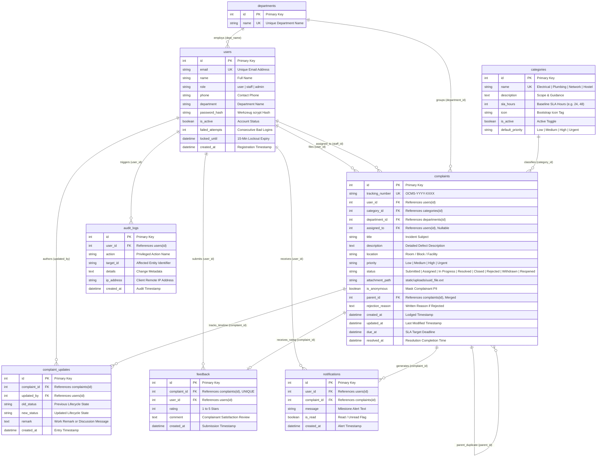

# Online Campus Complaints Management System (OCMS)
## System Design: Use Case Diagram & Entity-Relationship (ER) Diagram Specification
**Document Version:** 1.0  
**Standard Compliance:** IEEE Std 830-1998 & ISO/IEC/IEEE 42010  
**System Architecture:** 3-Tier Web Application (Flask, Jinja2, SQLite 3NF)  

---

## Table of Contents
1. [Overview & Standards](#1-overview--standards)
2. [UML Use Case Diagram](#2-uml-use-case-diagram)
   - [2.1 Actor Taxonomy](#21-actor-taxonomy)
   - [2.2 Use Case Diagram (Visual Model)](#22-use-case-diagram-visual-model)
   - [2.3 Detailed Use Case Specifications](#23-detailed-use-case-specifications)
3. [Entity-Relationship (ER) Diagram](#3-entity-relationship-er-diagram)
   - [3.1 Visual Entity Diagram (Crow's Foot Notation)](#31-visual-entity-diagram-crows-foot-notation)
   - [3.2 Entity Data Dictionary & Schema Constraints](#32-entity-data-dictionary--schema-constraints)
   - [3.3 Relationship Cardinalities & Business Rules](#33-relationship-cardinalities--business-rules)
4. [Downloadable Vector Assets](#4-downloadable-vector-assets)

---

## 1. Overview & Standards

This document establishes the functional user interaction model (**Use Case Diagram**) and the relational data architecture (**Entity-Relationship Diagram**) for the **Online Campus Complaints Management System (OCMS)**.

* **Use Case Diagram Standard**: UML 2.5 Specification with standard boundary, actor glyphs, associations, `<<include>>`, and `<<extend>>` dependencies.
* **Entity Diagram Standard**: Crow's Foot Entity-Relationship Notation complying with 3rd Normal Form (3NF) relational design principles and SQLite ACID constraints.

---

## 2. UML Use Case Diagram

### 2.1 Actor Taxonomy

| Actor Name | Type | Description | Primary Responsibilities |
|:---|:---|:---|:---|
| **Complainant** | Primary Human Actor | University Student, Hostel Resident, Faculty, or Campus Citizen. | Registers account, lodges maintenance grievances, attaches photos, tracks real-time progress, submits service ratings, and reopens unresolved cases. |
| **Technician (Staff)** | Primary Human Actor | Departmental tradesperson (Electrician, Plumber, Network Engineer, Carpenter). | Inspects assigned work queue, acknowledges incidents, transitions status (`In Progress` $\rightarrow$ `Resolved`), posts progress remarks, or rejects out-of-scope tickets. |
| **Administrator** | Primary Human Actor | Campus Estate Manager, Facility Director, or Hostel Warden. | Performs triage, allocates grievances to staff, overrides priorities, manages categories & SLAs, audits system activity, and exports CSV reports. |
| **SLA Scheduler** | Secondary System Actor | Automated background daemon / system timer. | Continuously tracks target deadlines (`due_at`), flags overdue tickets (`is_overdue = True`), and escalates SLA breaches to administrators. |

---

### 2.2 Use Case Diagram (Visual Model)

```mermaid
graph LR
    %% Primary Actors
    Student["Complainant<br/>(Student / Resident)"]
    Staff["Technician<br/>(Staff Officer)"]
    Admin["Campus Administrator<br/>(Estate Manager)"]
    Clock["SLA Scheduler<br/>(System Daemon)"]

    subgraph SystemBoundary ["Online Campus Complaints Management System (OCMS)"]
        %% Complainant Use Cases
        UC1((UC-01: Register & Authenticate))
        UC2((UC-02: Submit Grievance & Photo))
        UC3((UC-03: Compute SLA Deadline))
        UC4((UC-04: Mint Tracking Token))
        UC5((UC-05: Track Status Public / Private))
        UC6((UC-06: Post Discussion Comment))
        UC7((UC-07: Withdraw Pending Complaint))
        UC8((UC-08: Submit 1-5 Star Service Rating))
        UC9((UC-09: Reopen Grievance within 7 Days))

        %% Staff Use Cases
        UC10((UC-10: View Assigned Work Queue))
        UC11((UC-11: Progress Status to In Progress))
        UC12((UC-12: Mark Resolved with Notes))
        UC13((UC-13: Reject Ticket with Written Reason))

        %% Admin Use Cases
        UC14((UC-14: Triage & Allocate Technician))
        UC15((UC-15: Override Priority & Reassign))
        UC16((UC-16: Merge Duplicate Grievances))
        UC17((UC-17: Manage Categories & SLA Hours))
        UC18((UC-18: Manage User Accounts & Lockout))
        UC19((UC-19: Generate Executive CSV Reports))
        UC20((UC-20: Inspect Security Audit Trail))

        %% Daemon Use Cases
        UC21((UC-21: Monitor SLA Breaches & Flag Overdue))
        UC22((UC-22: Dispatch In-App Notifications))
    end

    %% Complainant Links
    Student --> UC1
    Student --> UC2
    Student --> UC5
    Student --> UC6
    Student --> UC7
    Student --> UC8
    Student --> UC9

    %% Staff Links
    Staff --> UC1
    Staff --> UC10
    Staff --> UC11
    Staff --> UC12
    Staff --> UC13
    Staff --> UC6

    %% Admin Links
    Admin --> UC1
    Admin --> UC14
    Admin --> UC15
    Admin --> UC16
    Admin --> UC17
    Admin --> UC18
    Admin --> UC19
    Admin --> UC20

    %% Scheduler Links
    Clock --> UC21

    %% Includes (Mandatory Sub-flows)
    UC2 -.->|<<include>>| UC3
    UC2 -.->|<<include>>| UC4
    UC2 -.->|<<include>>| UC22

    UC14 -.->|<<include>>| UC22
    UC11 -.->|<<include>>| UC22
    UC12 -.->|<<include>>| UC22
    UC21 -.->|<<include>>| UC22

    %% Extends (Conditional Branches)
    UC12 -.->|<<extend>>| UC8
    UC12 -.->|<<extend>>| UC9

    %% Styling
    classDef actor fill:#1e293b,stroke:#38bdf8,stroke-width:2px,color:#f8fafc;
    classDef core fill:#0f172a,stroke:#38bdf8,stroke-width:2px,color:#f8fafc;
    classDef inc fill:#0f766e,stroke:#2dd4bf,stroke-width:1.5px,color:#ccfbf1;
    classDef ext fill:#78350f,stroke:#fbbf24,stroke-width:1.5px,color:#fef3c7;
    class Student,Staff,Admin,Clock actor;
    class UC1,UC2,UC5,UC6,UC7,UC10,UC11,UC12,UC13,UC14,UC15,UC16,UC17,UC18,UC19,UC20,UC21 core;
    class UC3,UC4,UC22 inc;
    class UC8,UC9 ext;
```

---

### 2.3 Detailed Use Case Specifications

#### UC-02: Submit Grievance & Media Attachment
* **Primary Actor:** Complainant (Student / Resident)
* **Preconditions:** Complainant is authenticated and account is active (`is_active = True`).
* **Trigger:** Complainant clicks "Submit Complaint" on the portal.
* **Main Success Scenario:**
  1. Complainant selects Category (e.g., Electrical, Plumbing, Network).
  2. Complainant enters Title, Detailed Description, Room / Block Location, and Urgency (`Low`, `Medium`, `High`, `Urgent`).
  3. Complainant optionally selects Anonymity flag (`is_anonymous = True`).
  4. Complainant uploads supporting photo or PDF ($\le 5\text{ MB}$).
  5. System validates CSRF token, whitelisted extension (`.jpg`, `.jpeg`, `.png`, `.pdf`), and prepends 12-char hex UUID to prevent collisions.
  6. **`<<include>>` UC-03:** System computes SLA target deadline based on Category baseline and priority multiplier ($\text{Urgent}=0.25\times$, $\text{High}=0.5\times$, $\text{Medium}=1.0\times$).
  7. **`<<include>>` UC-04:** System mints unique sequential reference token (format: `OCMS-YYYY-XXXX`).
  8. System inserts record into `complaints` table with status `Submitted` and logs initial entry into `complaint_updates`.
  9. **`<<include>>` UC-22:** System generates in-app submission alert.
  10. System redirects user to success page displaying the reference badge and SLA target date.
* **Postconditions:** Grievance is persisted in SQLite database and visible in the Admin Triage Queue.

#### UC-14: Administrative Triage & Staff Allocation
* **Primary Actor:** Campus Administrator
* **Preconditions:** Administrator is logged in with `@admin_required` session role.
* **Main Success Scenario:**
  1. Administrator navigates to `/admin/complaints` and filters by `Submitted` status.
  2. Administrator selects ticket (e.g., `OCMS-2026-0042`) and reviews reported defect, room location, and photo.
  3. Administrator selects qualified technician from the appropriate campus department.
  4. Administrator submits assignment with optional administrative note.
  5. System updates `complaints.assigned_to = staff_id` and transitions status to `Assigned`.
  6. System appends milestone to `complaint_updates` timeline.
  7. System logs action into `audit_logs` capturing Admin ID, target ticket, and client IP address.
  8. **`<<include>>` UC-22:** System dispatches real-time notification to both the assigned technician and complainant.
* **Postconditions:** Incident appears in technician's active queue; SLA countdown continues.

#### UC-08: Submit 1-5 Star Service Rating (`<<extend>>` on UC-12)
* **Primary Actor:** Complainant
* **Preconditions:** Ticket status is `Resolved`. No prior feedback exists for this complaint (`complaint_id` is unique in `feedback`).
* **Main Success Scenario:**
  1. Complainant views resolved ticket details.
  2. System displays interactive 5-star rating widget.
  3. Complainant selects rating (1 to 5 stars) and enters review remarks.
  4. System inserts record into `feedback` table.
  5. System transitions ticket status from `Resolved` to `Closed`.
  6. System updates departmental and technician satisfaction KPI metrics.
* **Postconditions:** Grievance enters terminal `Closed` state; rating is permanently locked.

#### UC-09: Reopen Grievance within 7 Days (`<<extend>>` on UC-12)
* **Primary Actor:** Complainant
* **Preconditions:** Ticket status is `Resolved`, and current time is $\le 7$ days from `resolved_at`.
* **Main Success Scenario:**
  1. Complainant verifies that physical repair failed (e.g., circuit tripped again).
  2. Complainant clicks "Reopen Complaint" and provides mandatory failure explanation.
  3. System validates that $(\text{now} - \text{resolved\_at}).\text{days} \le 7$.
  4. System transitions status to `Reopened`, clears `resolved_at`, and appends reason to timeline.
  5. System alerts Administrator and assigned technician of the reopened case.

---

## 3. Entity-Relationship (ER) Diagram

### 3.1 Visual Entity Diagram (Crow's Foot Notation)

---

### 3.2 Entity Data Dictionary & Schema Constraints

| Entity | Primary Key | Foreign Keys | Key Constraints & Indexes | Description |
|:---|:---|:---|:---|:---|
| **`users`** | `id` | None | `email` (UNIQUE, INDEX), `role` (INDEX) | Stores credentials, user classifications (`user`, `staff`, `admin`), and security lockout timers. |
| **`departments`** | `id` | None | `name` (UNIQUE) | Lookup table for grouping staff technicians and facility assets. |
| **`categories`** | `id` | None | `name` (UNIQUE) | Configuration entity for complaint classes and baseline resolution expectations (`sla_hours`). |
| **`complaints`** | `id` | `user_id` $\rightarrow$ `users(id)` `category_id` $\rightarrow$ `categories(id)` `department_id` $\rightarrow$ `departments(id)` `assigned_to` $\rightarrow$ `users(id)` `parent_id` $\rightarrow$ `complaints(id)` | `tracking_number` (UNIQUE, INDEX), `status` (INDEX), `user_id` (INDEX) | Central ledger storing all incident tickets, SLA deadlines, file references, and lifecycle states. |
| **`complaint_updates`** | `id` | `complaint_id` $\rightarrow$ `complaints(id)` `updated_by` $\rightarrow$ `users(id)` | `complaint_id` (INDEX), `CASCADE ON DELETE` | Immutable append-only audit trail recording every status change, comment, and technician note. |
| **`feedback`** | `id` | `complaint_id` $\rightarrow$ `complaints(id)` `user_id` $\rightarrow$ `users(id)` | `complaint_id` (UNIQUE), `rating` $\in [1, 5]$ | Quality evaluation table enforcing exactly one rating per resolved complaint. |
| **`notifications`** | `id` | `user_id` $\rightarrow$ `users(id)` `complaint_id` $\rightarrow$ `complaints(id)` | `user_id` (INDEX) | In-app alerts informing complainants and staff of lifecycle transitions. |
| **`audit_logs`** | `id` | `user_id` $\rightarrow$ `users(id)` | `created_at` (INDEX) | Security log documenting administrative changes and client IP addresses. |

---

### 3.3 Relationship Cardinalities & Business Rules

1. **User to Complaints (`1 : N`)**:
   - A single complainant can submit **zero or many** complaints.
   - Each complaint is filed by **exactly one** user. If anonymous, `is_anonymous = True` masks PII while preserving internal foreign key integrity.
2. **Staff to Assigned Complaints (`0..1 : N`)**:
   - A staff member can be assigned **zero or many** complaints concurrently.
   - A newly submitted complaint has **zero** assignees (`assigned_to = NULL`). Once triaged, it is assigned to **at most one** technician.
3. **Complaint to Complaint Updates (`1 : N` Composition)**:
   - Every complaint has **one or more** timeline entries (initialized with `"Complaint registered online"` upon submission).
   - If a complaint is deleted, all associated updates are removed via cascading foreign keys (`ON DELETE CASCADE`).
4. **Complaint to Feedback (`1 : 0..1` Unique)**:
   - A complaint has **zero or one** feedback record.
   - The unique constraint on `feedback.complaint_id` prevents duplicate rating submissions for the same grievance.
5. **Complaint to Duplicate Parent (`0..1 : N` Self-Referential)**:
   - A duplicate ticket references a master incident via `parent_id`. Master incidents have `parent_id = NULL`.
6. **Category to Complaints (`1 : N` Restricted)**:
   - Deleting a category with active complaints is rejected by the database to ensure referential integrity.

---

## 4. Downloadable Vector Assets

* **Use Case Diagram (SVG)**: [`docs/use_case_diagram.svg`](file:///c:/Users/Gauri%20Rajesh/Desktop/OCMS/docs/use_case_diagram.svg)
* **Entity-Relationship Diagram (SVG)**: [`docs/entity_relationship_diagram.svg`](file:///c:/Users/Gauri%20Rajesh/Desktop/OCMS/docs/entity_relationship_diagram.svg)
* **Interactive Viewer & 1-Click PNG Exporter**: [`docs/use_case_and_entity_viewer.html`](file:///c:/Users/Gauri%20Rajesh/Desktop/OCMS/docs/use_case_and_entity_viewer.html)
